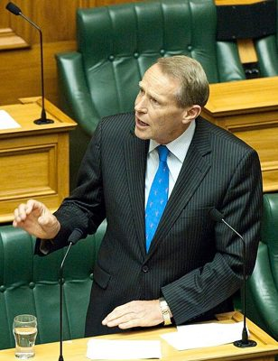

# Paul Hutchison

| | |
|---|---|
| **Party** | New Zealand National Party |
| **Status** | Former MP |
| **Now (Oct 2026)** | Retired at the 2014 election. Practises medicine in South Auckland; Entrust trustee and Vector director; Honorary Consul for Papua New Guinea (per Wikipedia; not independently re-verified for 2026). |
| **Electorate(s)** | Port Waikato (1999–2008); Hunua (2008–2014) |
| **Parliaments** | 46th, 47th, 48th, 49th, 50th |
| **First elected** | 1999 |
| **Born** | 1947 — Wellington |
| **Wikipedia** | [Paul Hutchison (politician)](https://en.wikipedia.org/wiki/Paul_Hutchison_(politician)) |

## Current status

Former MP and obstetrician/gynaecologist. According to Wikipedia he:
- practises in a high-needs South Auckland clinic
- is an Entrust trustee and Vector director
- is New Zealand's Honorary Consul for Papua New Guinea

## Biography

- **Early life:** born in 1947 in Wellington. He attended Onslow College.
- **Medicine:** MB ChB from Otago (1970); a specialist obstetrician and gynaecologist for nearly 30 years.
- **Personal:** married; four daughters. He has a Northland conservation block where he has planted more than 26,000 native trees.

## Political career

- **Electorates:** Port Waikato (1999–2008), then Hunua (2008–14).
- **Health:** opposition health spokesperson, then chair of the Health Committee (2009–14). He led five inquiries, including one on child health and preventing child abuse.
- **Retirement:** retired in 2014; Andrew Bayly succeeded him.

**Roles held:**

- MP for Port Waikato (1999–2008)
- MP for Hunua (2008–2014)
- Chair, Health Committee (2009–2014)
- Opposition spokesperson for health

## Record & notable actions

- **Smokefree law (2003):** one of only two National MPs to back the Smokefree Environments Amendment Act 2003.
- **Euthanasia (2003):** voted against the Death with Dignity bill.
- **Conscience votes:** voted for marriage equality (2013).
- **Recognition:** received the NZ Medical Association chair's award after retiring.

**Conscience votes** (recorded third-reading votes):

| Bill | Vote |
|---|---|
| [Marriage (Definition of Marriage) Amendment Bill — third reading, 17 Apr 2013](https://en.wikipedia.org/wiki/Marriage_(Definition_of_Marriage)_Amendment_Act_2013) | for |

## Controversies

- **Reading while driving (2009):** a motorist reported seeing him reading while driving, which prompted Acting PM Bill English to remind MPs about road rules.

## Sources

- <https://en.wikipedia.org/wiki/Paul_Hutchison>
- <https://en.wikipedia.org/wiki/Paul_Hutchison_(politician)>
- Photo: <https://commons.wikimedia.org/wiki/File:Paul_Hutchison_2013.jpg> — Rachel Park, NZDF Photographer — https://mfatimages.smugmug.com/CompleteLibrary/Approved-Images/i-DmcfCXK (CC BY 3.0)
