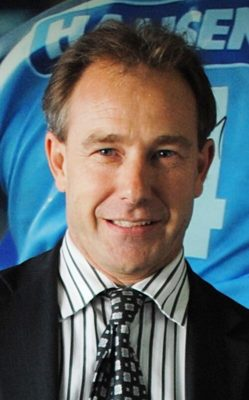

# Phil Heatley

| | |
|---|---|
| **Party** | New Zealand National Party |
| **Status** | Former MP |
| **Now (Oct 2026)** | Retired at the 2014 election to pursue private-sector opportunities; joined the Northland Regional Council in September 2015 (per NZ Herald). Current role not verified. |
| **Electorate(s)** | Whangārei (1999–2014) |
| **Parliaments** | 46th, 47th, 48th, 49th, 50th |
| **First elected** | 1999 |
| **Born** | 1967-04-05 |
| **Wikipedia** | [Phil Heatley](https://en.wikipedia.org/wiki/Phil_Heatley) |

## Current status

Former MP and minister. He retired at the 2014 election to "move on to fresh challenges and opportunities in the private sector". In September 2015 he joined the Northland Regional Council. His current role is not verified.

## Biography

- **Early life:** born on 5 April 1967 in Whangārei.
- **Engineering:** master's (Hons) in horticultural engineering from Massey. He was an agricultural engineer in the dairy industry and is a Fellow of IPENZ.
- **Volunteering:** worked as a volunteer on a relief hospital ship.

## Political career

- **Whangārei (1999–2014):** held the seat for 15 years.
- **Opposition spokesperson:** forestry, fisheries, regional development, early childhood education and energy.
- **Minister (2008–13):**
  - Housing and Fisheries from 2008.
  - Energy and Resources from December 2011.
  - Lost his portfolios in the January 2013 reshuffle, to Simon Bridges and Nick Smith.

**Roles held:**

- Minister of Housing (2008–2013)
- Minister of Fisheries / Fisheries and Aquaculture (2008–2011)
- Minister of Energy and Resources (2011–2013)
- MP for Whangārei (1999–2014)

## Record & notable actions

- **Housing:**
  - Unit Titles Act 2010.
  - Residential Tenancies Amendment Act 2010, which extended protections to boarding houses.
  - Introduced "reviewable tenancies" for state housing in 2011, ending "state house for life".
- **Fisheries:**
  - Aquaculture Legislation Amendment Act 2011.
  - Launched the ministerial inquiry into foreign charter fishing vessels.
- **Energy:**
  - Crown Minerals amendments to "promote" oil, gas and mineral exploration (2013).
  - New annual "block offer" for petroleum permits (2012).
- **Conscience votes:** voted against marriage equality (2013).

**Conscience votes** (recorded third-reading votes):

| Bill | Vote |
|---|---|
| [Marriage (Definition of Marriage) Amendment Bill — third reading, 17 Apr 2013](https://en.wikipedia.org/wiki/Marriage_(Definition_of_Marriage)_Amendment_Act_2013) | against |

## Controversies

- **Expenses (2010):** resigned his portfolios in February 2010 after "errors" were found in his expense claims. He was reinstated a month later after an Auditor-General review found no deliberate wrongdoing.

## Sources

- <https://en.wikipedia.org/wiki/Phil_Heatley>
- Photo: <https://commons.wikimedia.org/wiki/File:Phil_Heatley_(cropped).jpg> — New Zealand Government, Office of the Governor-General — https://gg.govt.nz/file/19933 (CC BY 4.0)
