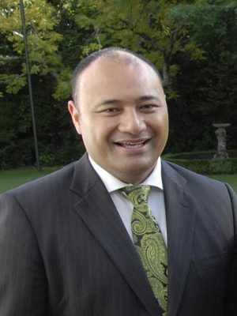

# Sam Lotu-Iiga

| | |
|---|---|
| **Party** | New Zealand National Party |
| **Status** | Former MP |
| **Now (Oct 2026)** | Retired at the 2017 election; became Manukau Institute of Technology's Deputy Chief Executive Pasifika (Sept 2017). Current role not verified. |
| **Electorate(s)** | Maungakiekie (2008–2017) |
| **Parliaments** | 49th, 50th, 51st |
| **First elected** | 2008 |
| **Born** | 1970-11-02 — Apia, Samoa |
| **Wikipedia** | [Sam Lotu-Iiga](https://en.wikipedia.org/wiki/Sam_Lotu-Iiga) |

## Current status

Former MP and minister. He retired at the 2017 election and in September 2017 became Manukau Institute of Technology's deputy chief executive Pasifika.

## Biography

- **Early life:** born on 2 November 1970 in Apia, Samoa. He grew up in Māngere and attended Auckland Grammar.
- **Education:** BCom/LLB and MCom (Hons) from Auckland; MBA from Cambridge, where he played rugby for the NZ Barbarians.
- **Career:** Russell McVeagh lawyer, Bankers Trust analyst, Macquarie Bank consultant.
- **Title:** holds the Samoan high chiefly title Peseta.
- **Personal:** married to Jules; two children. A Baptist.

## Political career

- **Auckland City Council (2007):** elected for Citizens & Ratepayers. He kept the seat until 2009, which drew criticism.
- **Maungakiekie (2008):** won the seat from Labour by 1,942 votes, one of the biggest swings in the country.
- **Committee chair:** Social Services Committee (2011–14), overseeing the welfare reforms.
- **Cabinet (January 2014):** Pacific Island Affairs.
- **From October 2014:** Pacific Peoples, Ethnic Communities and Corrections. He swapped Corrections for Local Government in December 2015.
- **Retirement:** announced in December 2016.

**Roles held:**

- Minister for Pacific Peoples (2014–2016)
- Minister of Corrections (2014–2015)
- Minister of Local Government (2015–2016)
- Minister for Ethnic Communities (2014–2016)
- MP for Maungakiekie (2008–2017)
- Chair, Social Services Committee (2011–2014)
- Auckland City Councillor (2007–2009)

## Record & notable actions

- **Conscience votes:** voted against marriage equality (2013).

**Conscience votes** (recorded third-reading votes):

| Bill | Vote |
|---|---|
| [Marriage (Definition of Marriage) Amendment Bill — third reading, 17 Apr 2013](https://en.wikipedia.org/wiki/Marriage_(Definition_of_Marriage)_Amendment_Act_2013) | against |

## Controversies

- **Mt Eden Prison (2015):** as Corrections Minister he faced the Serco-run Mt Eden prison "fight club" revelations and the government takeover of the prison. *(Context: Wikipedia; specific sourcing not in the extract consulted, so this is noted only briefly.)*

## Sources

- <https://en.wikipedia.org/wiki/Sam_Lotu-Iiga>
- Photo: <https://commons.wikimedia.org/wiki/File:Sam_Lotu-Iiga,_2009.jpg> — Governor General of New Zealand — https://gg.govt.nz/file/21795 (CC BY-SA 4.0)
