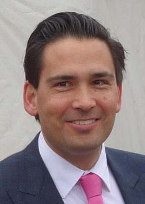

# Simon Bridges

| | |
|---|---|
| **Party** | New Zealand National Party |
| **Status** | Former MP |
| **Electorate(s)** | Tauranga (2008–2022) |
| **Parliaments** | 49th, 50th, 51st, 52nd, 53rd |
| **First elected** | 2008 |
| **Born** | 1976-10-12 — Auckland, New Zealand |
| **Wikipedia** | [Simon Bridges](https://en.wikipedia.org/wiki/Simon_Bridges) |

## Political career

**Offices held** (from the Wikipedia infobox; dates are years):

- Leader of the Opposition (2018–2020)
- Leader of the National Party (2018–2020)
- Shadow Leader of the House (2017–2018)
- Leader of the House (2017–2017)
- Minister of Economic Development (2016–2017)
- Minister of Transport (2014–2017)
- Minister for Communications (2016–2017)

## Record & notable actions

**Conscience votes** (recorded third-reading votes):

| Bill | Vote |
|---|---|
| [Marriage (Definition of Marriage) Amendment Bill — third reading, 17 Apr 2013](https://en.wikipedia.org/wiki/Marriage_(Definition_of_Marriage)_Amendment_Act_2013) | against |
| [End of Life Choice Bill — third reading, 13 Nov 2019](https://en.wikipedia.org/wiki/End_of_Life_Choice_Act_2019) | against |
| [Abortion Legislation Bill — third reading, 18 Mar 2020](https://en.wikipedia.org/wiki/Abortion_Legislation_Act_2020) | against |
| [Conversion Practices Prohibition Legislation Bill — third reading, 15 Feb 2022](https://www.rnz.co.nz/news/national/461599/politicians-react-as-bill-to-ban-conversion-therapy-passes) | against |

## Sources

- <https://en.wikipedia.org/wiki/Simon_Bridges>
- Photo: <https://commons.wikimedia.org/wiki/File:Simon-Bridges-Free-Crop.jpg> — User:Schwede66 — This image has been extracted from another file (CC BY-SA 4.0)
