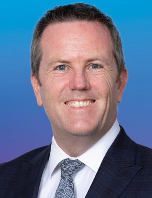

# Simon O'Connor

| | |
|---|---|
| **Party** | New Zealand National Party |
| **Status** | Former MP |
| **Now (Oct 2026)** | Lost Tāmaki to ACT's Brooke van Velden at the 2023 election (list #54, not returned). Current activities not detailed in the sources consulted. |
| **Electorate(s)** | Tāmaki (2011–2023) |
| **Parliaments** | 50th, 51st, 52nd, 53rd |
| **First elected** | 2011 |
| **Born** | 1976-02-25 |
| **Wikipedia** | [Simon O'Connor](https://en.wikipedia.org/wiki/Simon_O%27Connor) |

## Current status

Former MP. ACT targeted his Tāmaki seat in 2023, citing his socially conservative views, and deputy leader Brooke van Velden won it by 4,158 votes. His list place of #54 was too low for him to return. His activities since then are not detailed in the sources consulted. He is Simon Bridges' brother-in-law.

## Biography

- **Early life:** born 25 February 1976 and raised in Whangārei, where he attended Pompallier College.
- **Religious training:** trained for the Catholic priesthood, including two years in Fiji and prison and army chaplaincy work, but did not seek ordination.
- **Education:** BA, BTheol and MA (first-class honours) in political studies from the University of Auckland.
- **Work:** contracts manager at Southern Cross.
- **Other roles:** chaired Monarchy New Zealand (2010–12).
- **Personal:** married Rachel Trimble, Simon Bridges' sister, in 2016; five stepchildren.

## Political career

- **Tāmaki:** replaced Allan Peachey as candidate shortly before the 2011 election and held the seat from 2011 to 2023.
- **Committee chair:**
  - Health Committee (2014–17), whose euthanasia inquiry recommended no law change.
  - Foreign Affairs, Defence and Trade Committee (2017–20).
- **Spokesperson:** corrections (2017–23), customs, arts, and internal affairs.
- **2021:** briefly resigned his portfolios when Collins demoted Bridges.

**Roles held:**

- MP for Tāmaki (2011–2023)
- Chair, Health Committee (2014–2017); Foreign Affairs, Defence and Trade Committee (2017–2020)
- National spokesperson for corrections (2017–2023), customs, arts, internal affairs
- Chair, Monarchy New Zealand (2010–2012)

## Record & notable actions

- **Conscience votes:**
  - Voted against marriage equality, End of Life Choice, abortion reform, and the 2022 conversion-practices ban; he was one of eight against the last (see table).
  - Opposed raising the drinking age and supported Easter Sunday trading.
- **Human rights:**
  - Hosted Tibetan leader Penpa Tsering at Parliament (2023).
  - Challenged Iran's ambassador over the repression of protests.

**Conscience votes** (recorded third-reading votes):

| Bill | Vote |
|---|---|
| [Marriage (Definition of Marriage) Amendment Bill — third reading, 17 Apr 2013](https://en.wikipedia.org/wiki/Marriage_(Definition_of_Marriage)_Amendment_Act_2013) | against |
| [End of Life Choice Bill — third reading, 13 Nov 2019](https://en.wikipedia.org/wiki/End_of_Life_Choice_Act_2019) | against |
| [Abortion Legislation Bill — third reading, 18 Mar 2020](https://en.wikipedia.org/wiki/Abortion_Legislation_Act_2020) | against |
| [Conversion Practices Prohibition Legislation Bill — third reading, 15 Feb 2022](https://www.rnz.co.nz/news/national/461599/politicians-react-as-bill-to-ban-conversion-therapy-passes) | against |

## Controversies

- **Euthanasia remark (2017):** on World Suicide Prevention Day he said Jacinda Ardern was "happy to encourage the suicide of the elderly, disabled, and sick".
- **Abortion debate (2020):** quoted "Vengeance is mine… saith the Lord" in Latin during the abortion bill debate.
- **Roe v Wade (June 2022):** posted that the overturning of Roe v Wade was a "good day". He removed the post after Luxon said it was "causing distress", then apologised to colleagues. ([RNZ](https://www.rnz.co.nz/news/national/469788/national-mp-removes-post-following-roe-v-wade-decision))

## Sources

- <https://www.rnz.co.nz/news/national/469788/national-mp-removes-post-following-roe-v-wade-decision>
- <https://archive.electionresults.govt.nz/electionresults_2023/electorate-details-50.html>
- <https://en.wikipedia.org/wiki/Simon_O%27Connor>
- Photo: <https://commons.wikimedia.org/wiki/File:OCONNOR,_Simon_-_Tamaki_(cropped).png> — New Zealand National Party — New Zealand National Party, per Ticket:2023090110001204 (CC BY-SA 4.0)
