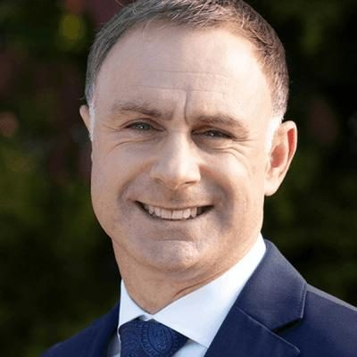

# Simon Watts

| | |
|---|---|
| **Party** | New Zealand National Party |
| **Status** | Current MP — standing in 2026 |
| **Now (Oct 2026)** | Minister of Climate Change and Minister of Revenue (since 2023), Minister of Local Government (since Jan 2025), Minister for Auckland (since Apr 2026) and Minister for Building and Construction (since 13 Aug 2026, after Chris Penk's dismissal); MP for North Shore; #13 on National's 2026 list and re-contesting North Shore. |
| **Electorate(s)** | North Shore (2020–) |
| **Parliaments** | 53rd, 54th |
| **First elected** | 2020 |
| **2026 election** | list #13, standing in North Shore |
| **Wikipedia** | [Simon Watts](https://en.wikipedia.org/wiki/Simon_Watts) |

## Current status

Minister of Climate Change and Revenue since November 2023. He joined Cabinet in April 2024 and added Local Government (and Energy, until April 2026) in January 2025. He became Minister for Auckland in April 2026 and Minister for Building and Construction on 13 August 2026, after Chris Penk was sacked. He is MP for North Shore and #13 on National's 2026 list.

During the August 2026 leadership crisis, Watts was among the MPs who did not publicly confirm their support for Luxon before the caucus vote. ([NZ Gazette](https://gazette.govt.nz/notice/id/2026-vr4558), [Wikipedia](https://en.wikipedia.org/wiki/August_2026_New_Zealand_National_Party_leadership_election))

## Biography

- **Early life:** grew up in Cambridge (Waikato) in an orcharding family. He has had type 1 diabetes since he was a toddler.
- **Education:** Bachelor of Management Studies (accounting and finance) from the University of Waikato, and a Bachelor of Health Science (paramedicine) from AUT.
- **Career:**
  - Chartered accountant.
  - Worked for the Royal Bank of Scotland in London during the 2008 financial crisis.
  - Deputy CFO of Waitematā DHB.
  - Front-line St John ambulance officer.
- **Personal:** married with two sons.

## Political career

- **2018:** lost the Northcote by-election selection to Dan Bidois.
- **2020:** selected for North Shore and won by 3,734 votes. He was spokesperson for local government (a strong critic of Three Waters), climate change, ACC and other portfolios. His member's bill on ACC notices of decisions was defeated at first reading in 2021.
- **2023:** held North Shore by 16,330 votes and became Minister of Climate Change and Revenue (outside Cabinet). He was promoted to Cabinet in April 2024. ([Electoral Commission](https://archive.electionresults.govt.nz/electionresults_2023/electorate-details-30.html))

**Roles held:**

- Minister of Climate Change (2023–)
- Minister of Revenue (2023–)
- Minister of Local Government (2025–)
- Minister for Energy (2025–2026)
- Minister for Auckland (2026–)
- Minister for Building and Construction (Aug 2026–)
- National spokesperson for local government, regional development, ACC, climate change, statistics (2020–2023)
- MP for North Shore (2020–)

## Record & notable actions

**Climate**
- Attended COP28 days after taking office and said New Zealand would advocate for a global fossil-fuel phase-out, while also reversing the oil-and-gas exploration ban. ([RNZ](https://www.rnz.co.nz/news/political/503501/new-climate-change-minister-simon-watts-not-expecting-criticism-at-cop28-over-fossil-fuels-u-turn))
- Released a five-pillar climate strategy and the second emissions reduction plan (2024).
- Closed NZ Green Investment Finance (April 2025). ([RNZ](https://www.rnz.co.nz/news/political/557556/government-s-green-investment-bank-to-be-shut-down))
- Withdrew New Zealand from the Beyond Oil & Gas Alliance (June 2025).
- A legal challenge to the government's climate plans by Lawyers for Climate Action and the Environmental Law Initiative was heard in the High Court in 2026. ([RNZ](https://www.rnz.co.nz/news/environment/589666/government-s-climate-change-plans-go-to-the-high-court))

**Energy**
- Announced a government-backed LNG import facility in Taranaki, funded by a levy on electricity of NZ$2–4/MWh (February 2026).

**Local government**
- With Chris Bishop, proposed abolishing elected regional councils (November 2025). ([RNZ](https://www.rnz.co.nz/news/political/579978/no-more-regional-councils-major-shake-up-of-local-government-announced))
- Gave councils three months to develop amalgamation plans (May 2026). ([RNZ](https://www.rnz.co.nz/news/political/594289/government-gives-councils-amalgamation-ultimatum))
- Ordered a full review of the Dog Control Act after fatal attacks (March 2026). ([RNZ](https://www.rnz.co.nz/news/national/590245/government-orders-complete-review-of-dog-control-act-after-spate-of-attacks))

**Conscience votes**
- He was in Parliament for the 2022 conversion-practices vote but was not among the eight National MPs recorded as opposed.

## Controversies

- **Climate criticism:** the Greens and climate groups criticised him for leaving the Beyond Oil & Gas Alliance and for the government's climate-policy rollbacks, which are now the subject of litigation (see above).
- No personal scandals are recorded in the sources consulted.

<!-- GENERATED:2026-candidacy START -->
## 2026 candidacy

- **Electorate:** North Shore
- **List ranking:** 13

_Source: candidate questionnaire answers published on [policy.nz](https://policy.nz/2026/party-vote/parties/national-party), retrieved Oct 2026._
<!-- GENERATED:2026-candidacy END -->

## Sources

- <https://www.electionresults.govt.nz/electionresults_2020/electorate-details-30.html>
- <https://archive.electionresults.govt.nz/electionresults_2023/electorate-details-30.html>
- <https://www.rnz.co.nz/news/political/503501/new-climate-change-minister-simon-watts-not-expecting-criticism-at-cop28-over-fossil-fuels-u-turn>
- <https://www.rnz.co.nz/news/political/557556/government-s-green-investment-bank-to-be-shut-down>
- <https://www.rnz.co.nz/news/environment/589666/government-s-climate-change-plans-go-to-the-high-court>
- <https://www.rnz.co.nz/news/national/590245/government-orders-complete-review-of-dog-control-act-after-spate-of-attacks>
- <https://www.rnz.co.nz/news/political/594289/government-gives-councils-amalgamation-ultimatum>
- <https://www.rnz.co.nz/news/political/579978/no-more-regional-councils-major-shake-up-of-local-government-announced>
- <https://gazette.govt.nz/notice/id/2026-vr4558>
- <https://en.wikipedia.org/wiki/August_2026_New_Zealand_National_Party_leadership_election>
- <https://en.wikipedia.org/wiki/Simon_Watts>
- <https://policy.nz/2026/party-vote/parties/national-party>
- Photo: <https://cdn.sanity.io/images/ubdwo62y/production/2a78ad4c35017bef8a6d520e79591c2e61ada2fa-1024x1024.jpg> — Supplied to policy.nz by the candidate/party (Not stated (candidate photo supplied to policy.nz; used for identification))
