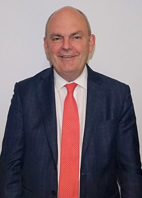

# Steven Joyce

| | |
|---|---|
| **Party** | New Zealand National Party |
| **Status** | Former MP |
| **Now (Oct 2026)** | Left Parliament March 2018. Runs consultancy Joyce Advisory (since 2018); chairman of NZME (owner of the NZ Herald and Newstalk ZB) since 3 June 2025. CNZM (2025 King's Birthday Honours). |
| **Parliaments** | 49th, 50th, 51st, 52nd |
| **First elected** | 2008 |
| **Born** | 1963-04-07 — New Plymouth, Taranaki, New Zealand |
| **Wikipedia** | [Steven Joyce](https://en.wikipedia.org/wiki/Steven_Joyce) |

## Current status

Steven Joyce has been chairman of NZME, which owns the NZ Herald and Newstalk ZB, since 3 June 2025. He also runs the consultancy Joyce Advisory, set up in 2018. He was appointed a Companion of the New Zealand Order of Merit (CNZM) in the 2025 King's Birthday Honours. ([NZ Herald](https://www.nzherald.co.nz/business/companies/nzme-targets-12m-savings-as-shareholders-vote-on-steven-joyce-joining-board-as-chair/JTJDMM2D35D4BBQ6SI5KGGYIBA/))

## Biography

- **Early life and education:** born 7 April 1963 in New Plymouth to grocer parents. He attended Francis Douglas Memorial College and graduated BSc (zoology) from Massey University.
- **Broadcasting:** co-founded Energy FM in New Plymouth. He then built RadioWorks over 17 years into 22 stations, and received about NZ$6m when CanWest bought it in 2001.
- **National Party:** campaign manager in 2005 and 2008, and later chief executive of Jasons Travel Media.
- **Personal:** married to Suzanne; two children.

## Political career

- **Entry to Parliament:** list-only MP from 2008, and a minister from his first day.
- **Transport and Communications (2008–11):**
  - Introduced the ban on hand-held phones while driving.
  - Raised the driving age to 16.
  - Reversed the "right-hand rule" at intersections.
  - Set up Auckland Transport.
  - Led the Ultra-Fast Broadband rollout.
- **Senior portfolios:** Tertiary Education (from 2010), then Economic Development and Science (2011–16).
- **"Minister of everything":** handled government troubleshooting, including Novopay and the 2013 Fonterra botulism scare.
- **Finance:** Minister of Finance under Bill English (December 2016 – October 2017).
- **Resignation:** after Simon Bridges won the 2018 leadership race, Joyce resigned from Parliament on 6 March 2018. This was reportedly after he was not offered the finance role. ([Newshub](http://www.newshub.co.nz/home/politics/2018/03/steven-joyce-resigns-from-the-national-party.html))

**Roles held:**

- Minister of Finance; Minister for Infrastructure (2016–2017)
- Minister for Economic Development (2011–2016)
- Minister of Science and Innovation (2011–2016)
- Minister for Tertiary Education, Skills and Employment (2010–2016)
- Minister of Transport (2008–2011)
- Minister for Communications and IT (2008–2011)
- National campaign manager (2005, 2008, 2011, 2014, 2017)
- National finance spokesperson (2017–2018)
- List MP (2008–2018)

## Record & notable actions

- **SkyCity deal (2013):** agreed that SkyCity Auckland could have more pokie machines and gaming tables in exchange for building a NZ$402m convention centre. Critics said this traded gambling harm for infrastructure. ([TVNZ](http://tvnz.co.nz/politics-news/skycity-convention-centre-set-create-800-jobs-joyce-5435254))
- **"$11 billion hole" (2017):** alleged an NZ$11.7b hole in Labour's fiscal plan. Economists disputed the claim and Labour rejected it.
- **Conscience votes:** voted for marriage equality (2013).

**Conscience votes** (recorded third-reading votes):

| Bill | Vote |
|---|---|
| [Marriage (Definition of Marriage) Amendment Bill — third reading, 17 Apr 2013](https://en.wikipedia.org/wiki/Marriage_(Definition_of_Marriage)_Amendment_Act_2013) | for |

## Controversies

- **Waitangi (2016):** a protester threw a sex toy at him over the TPP. The incident was widely publicised but is not a controversy about his conduct. ([Guardian](https://www.theguardian.com/world/2016/feb/16/new-zealand-mp-dildo-baggins-cops-sex-toy-in-the-face-and-takes-ribbing-on-the-chin))
- **University of Waikato consultancy:** RNZ reported in 2023 that the university paid Joyce Advisory about NZ$1m from 2019 to 2023. National later backed a Waikato medical school. The university said Joyce did no lobbying, but in 2024 the Auditor-General criticised it for not procuring his services competitively. ([RNZ](https://www.rnz.co.nz/news/in-depth/491859/cash-strapped-waikato-university-has-paid-former-cabinet-minister-steven-joyce-nearly-1-million))
- **Driving convictions:** while Transport Minister in 2010, he disclosed two careless-driving convictions from 1988–89.

## Sources

- <http://www.newshub.co.nz/home/politics/2018/03/steven-joyce-resigns-from-the-national-party.html>
- <http://tvnz.co.nz/politics-news/skycity-convention-centre-set-create-800-jobs-joyce-5435254>
- <https://www.theguardian.com/world/2016/feb/16/new-zealand-mp-dildo-baggins-cops-sex-toy-in-the-face-and-takes-ribbing-on-the-chin>
- <https://www.rnz.co.nz/news/in-depth/491859/cash-strapped-waikato-university-has-paid-former-cabinet-minister-steven-joyce-nearly-1-million>
- <https://www.nzherald.co.nz/business/companies/nzme-targets-12m-savings-as-shareholders-vote-on-steven-joyce-joining-board-as-chair/JTJDMM2D35D4BBQ6SI5KGGYIBA/>
- <https://www.rnz.co.nz/news/national/515880/auditor-general-criticises-way-university-of-waikato-contracted-steven-joyce>
- <https://www.rnz.co.nz/news/national/562810/king-s-birthday-honours-dai-henwood-tim-southee-and-jude-dobson-among-those-recognised>
- <https://en.wikipedia.org/wiki/Steven_Joyce>
- Photo: <https://commons.wikimedia.org/wiki/File:Steven_Joyce_in_Estonia,_March_2016.jpg> — Estonian Foreign Ministry — Välisminister Marina Kaljurand, Soome välisminister Timo Soini ja Uus-Meremaa IT minister Steven Joyce avasid täna Eesti, Soome ja Uus-Meremaa innovatsioonifoorumi. (CC BY 2.0)
