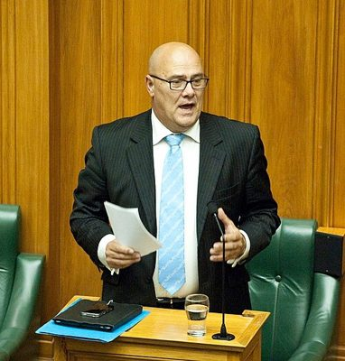

# Tau Henare

| | |
|---|---|
| **Party** | New Zealand National Party |
| **Status** | Former MP |
| **Electorate(s)** | Northern Maori (1993–1996); Te Tai Tokerau (1996–1999) |
| **Parliaments** | 43th, 44th, 45th, 48th, 49th, 50th |
| **First elected** | 1993 |
| **Born** | 1960-09-29 — Ōtara, Auckland, New Zealand |
| **Wikipedia** | [Tau Henare](https://en.wikipedia.org/wiki/Tau_Henare) |

## Record & notable actions

**Conscience votes** (recorded third-reading votes):

| Bill | Vote |
|---|---|
| [Marriage (Definition of Marriage) Amendment Bill — third reading, 17 Apr 2013](https://en.wikipedia.org/wiki/Marriage_(Definition_of_Marriage)_Amendment_Act_2013) | for |

## Sources

- <https://en.wikipedia.org/wiki/Tau_Henare>
- Photo: <https://commons.wikimedia.org/wiki/File:Tau_Henare_2013.jpg> — Rachel Park, NZDF Photographer — https://mfatimages.smugmug.com/CompleteLibrary/Approved-Images/i-pnrpx8B (CC BY 3.0)
