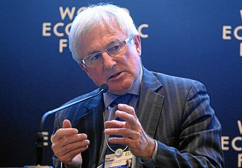

# Tim Groser

| | |
|---|---|
| **Party** | New Zealand National Party |
| **Status** | Former MP |
| **Parliaments** | 48th, 49th, 50th, 51st |
| **First elected** | 2005 |
| **Born** | 1950-03-06 — Perth, Scotland |
| **Wikipedia** | [Tim Groser](https://en.wikipedia.org/wiki/Tim_Groser) |

## Political career

**Offices held** (from the Wikipedia infobox; dates are years):

- New Zealand Ambassador; to the United States (2016–2018)
- Minister of Trade (2008–2015)

## Record & notable actions

**Conscience votes** (recorded third-reading votes):

| Bill | Vote |
|---|---|
| [Marriage (Definition of Marriage) Amendment Bill — third reading, 17 Apr 2013](https://en.wikipedia.org/wiki/Marriage_(Definition_of_Marriage)_Amendment_Act_2013) | for |

## Sources

- <https://en.wikipedia.org/wiki/Tim_Groser>
- Photo: <https://commons.wikimedia.org/wiki/File:The_East_Asia_Context_Tim_Groser_(8408582251).jpg> — World Economic Forum from Cologny, Switzerland — The East Asia Context: Tim Groser Uploaded by January (CC BY-SA 2.0)
