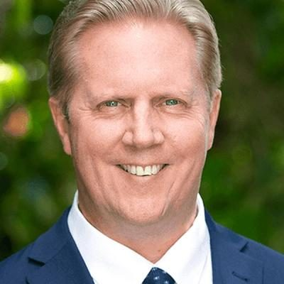

# Todd McClay

| | |
|---|---|
| **Party** | New Zealand National Party |
| **Status** | Current MP — standing in 2026 |
| **Electorate(s)** | Rotorua (2008–) |
| **Parliaments** | 49th, 50th, 51st, 52nd, 53rd, 54th |
| **First elected** | 2008 |
| **Born** | 1968-11-22 — Rotorua, Bay of Plenty, New Zealand |
| **2026 election** | list #10, standing in Rotorua |
| **Wikipedia** | [Todd McClay](https://en.wikipedia.org/wiki/Todd_McClay) |

## Political career

**Offices held** (from the Wikipedia infobox; dates are years):

- Minister for Trade and Investment Minister of Agriculture Minister of Forestry (2023–)
- Minister of Revenue (2013–2015)

## Record & notable actions

**Conscience votes** (recorded third-reading votes):

| Bill | Vote |
|---|---|
| [Marriage (Definition of Marriage) Amendment Bill — third reading, 17 Apr 2013](https://en.wikipedia.org/wiki/Marriage_(Definition_of_Marriage)_Amendment_Act_2013) | against |
| [End of Life Choice Bill — third reading, 13 Nov 2019](https://en.wikipedia.org/wiki/End_of_Life_Choice_Act_2019) | against |
| [Abortion Legislation Bill — third reading, 18 Mar 2020](https://en.wikipedia.org/wiki/Abortion_Legislation_Act_2020) | against |
| [Conversion Practices Prohibition Legislation Bill — third reading, 15 Feb 2022](https://www.rnz.co.nz/news/national/461599/politicians-react-as-bill-to-ban-conversion-therapy-passes) | against |

<!-- GENERATED:2026-candidacy START -->
## 2026 candidacy

- **Electorate:** Rotorua
- **List ranking:** 10

_Source: candidate questionnaire answers published on [policy.nz](https://policy.nz/2026/party-vote/parties/national-party), retrieved Oct 2026._
<!-- GENERATED:2026-candidacy END -->

## Sources

- <https://en.wikipedia.org/wiki/Todd_McClay>
- <https://policy.nz/2026/party-vote/parties/national-party>
- Photo: <https://cdn.sanity.io/images/ubdwo62y/production/2983096e196077f2f113f800d6ba66d14c16e6ec-1024x1024.jpg> — Supplied to policy.nz by the candidate/party (Not stated (candidate photo supplied to policy.nz; used for identification))
