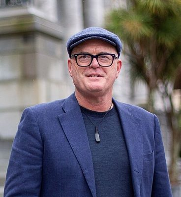

# Todd Muller

| | |
|---|---|
| **Party** | New Zealand National Party |
| **Status** | Former MP |
| **Now (Oct 2026)** | Retired from Parliament at the 2023 election (announced March 2023). Mental-health advocate; post-politics activity is not detailed in the sources consulted. |
| **Electorate(s)** | Bay of Plenty (2014–2023) |
| **Parliaments** | 51st, 52nd, 53rd |
| **First elected** | 2014 |
| **Born** | 1968-12-23 — Te Aroha, New Zealand |
| **Wikipedia** | [Todd Muller](https://en.wikipedia.org/wiki/Todd_Muller) |

## Current status

Former MP. He retired at the 2023 election, saying he no longer had "enough fire in the belly" and doubted his mental health could withstand ministerial pressures. He has spoken publicly about his anxiety and panic attacks. His activities since 2023 are not detailed in the sources consulted.

## Biography

- **Early life:** born 23 December 1968 in Te Aroha and raised on his parents' kiwifruit orchard at Te Puna. He attended Tauranga Boys' College and holds a master's degree from the University of Waikato.
- **Career:**
  - Executive assistant to Prime Minister Jim Bolger (1994–97).
  - Zespri (2001–06).
  - Chief executive of the post-harvest company Apata (2006–11).
  - Fonterra's group director of co-operative affairs (2012–14), including during the 2013 botulism scare.
- **Personal:** married with three children. He is a practising Catholic.

## Political career

- **Bay of Plenty:** succeeded Tony Ryall in 2014, winning by 15,096 votes. He held the seat in 2017 and 2020 (majority 3,415).
- **Zero Carbon Act:** as climate change spokesperson he worked with James Shaw on the Act, and National voted for it in 2019.
- **Leader (22 May 2020):** toppled Simon Bridges with Nikki Kaye as deputy.
- **Resignation (14 July 2020):** quit after 53 days, the shortest leadership of any parliamentary party, citing his mental health. ([Newshub](https://www.newshub.co.nz/home/politics/2020/07/todd-muller-resigns-as-national-party-leader.html))
- **2021:** admitted he was one of the MPs quoted anonymously criticising Harete Hipango, and that he had passed inside information to the Politik website. He announced his retirement, then reversed it after Luxon became leader.
- **March 2023:** confirmed his retirement.

**Roles held:**

- Leader of the National Party and Leader of the Opposition (22 May–14 Jul 2020)
- Chair, Foreign Affairs, Defence and Trade Committee (2017)
- National spokesperson for agriculture, climate change, forestry (2017–2020); agriculture & climate change (2023)
- MP for Bay of Plenty (2014–2023)

## Record & notable actions

- **Sunscreen (Product Safety Standard) Act 2022:** his member's bill passed unanimously. It makes sunscreen standards enforceable under the Fair Trading Act. ([Stuff](https://www.stuff.co.nz/business/127942400/tighter-control-on-sunscreen-after-safety-standards-added-to-fair-trading-act))
- **Positions:**
  - Socially conservative: voted against the End of Life Choice and abortion bills.
  - Backed abortion "safe areas" and the 2022 conversion-practices ban.
  - Advocated bipartisanship on climate change and mental health.

**Conscience votes** (recorded third-reading votes):

| Bill | Vote |
|---|---|
| [End of Life Choice Bill — third reading, 13 Nov 2019](https://en.wikipedia.org/wiki/End_of_Life_Choice_Act_2019) | against |
| [Abortion Legislation Bill — third reading, 18 Mar 2020](https://en.wikipedia.org/wiki/Abortion_Legislation_Act_2020) | against |
| Conversion Practices Prohibition Legislation Bill — third reading, 15 Feb 2022 | not among the 8 National MPs recorded as opposed (25 National MPs voted in favour) |

## Controversies

- **"OK boomer" (2019):** heckled Green MP Chlöe Swarbrick, who replied "OK boomer"; the exchange went viral.
- **MAGA cap (2020):** planned to display a "Make America Great Again" cap in his office, then dropped the idea.
- **Leaks (2020–21):** his short leadership was dogged by leaks. He later admitted briefing journalists against a colleague (see above).

## Sources

- <https://archive.electionresults.govt.nz/electionresults_2014/electorate-2.html>
- <https://www.stuff.co.nz/national/politics/300015307/national-plummets-to-306-per-cent-in-newshubreid-research-poll>
- <https://www.newshub.co.nz/home/politics/2020/07/todd-muller-resigns-as-national-party-leader.html>
- <https://www.stuff.co.nz/business/127942400/tighter-control-on-sunscreen-after-safety-standards-added-to-fair-trading-act>
- <https://www.parliament.nz/en/pb/bills-and-laws/bills-proposed-laws/document/BILL_109343/sunscreen-product-safety-standard-bill>
- <https://en.wikipedia.org/wiki/Todd_Muller>
- Photo: <https://commons.wikimedia.org/wiki/File:Todd_Muller_2023_cropped.jpg> — KiwiAgriPolitics — Edited version of : cropped to make the subject's face larger (CC BY-SA 4.0)
