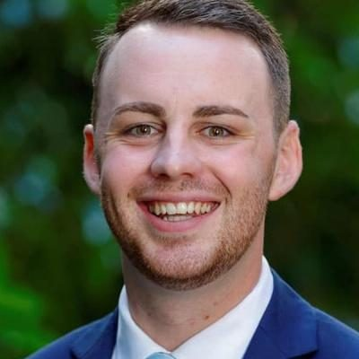

# Tom Rutherford

| | |
|---|---|
| **Party** | New Zealand National Party |
| **Status** | Current MP — standing in 2026 |
| **Now (Oct 2026)** | Backbench MP for Bay of Plenty (since 2023); #27 on National's 2026 list and contesting the new Mount Maunganui electorate (which replaces Bay of Plenty). |
| **Electorate(s)** | Bay of Plenty (2023–) |
| **Parliaments** | 54th |
| **First elected** | 2023 |
| **2026 election** | list #27, standing in Mt Maunganui |
| **Wikipedia** | [Tom Rutherford](https://en.wikipedia.org/wiki/Tom_Rutherford) |

> **List rank note:** policy.nz (in the 2026 candidacy section below) gives #28. The Electoral Commission's official National list gives **#27**. From #14 down, policy.nz's numbering appears to still include Chris Penk, who withdrew. ([Electoral Commission](https://vote.nz/2026-general-election/voting-in-the-election/party-lists))

## Current status

Backbench MP for Bay of Plenty since 2023. He is #27 on National's 2026 list and is contesting Mount Maunganui, the electorate that replaces Bay of Plenty after the boundary review.

## Biography

- **Early life:** raised in the Bay of Plenty. His mother, Sharon Nightingale, is National's Bay of Plenty event manager. He was a Youth MP in 2013.
- **Career:** communications executive, including working for Rotorua Lakes Council under Mayor Tania Tapsell.
- **Community roles:**
  - Hockey New Zealand umpire.
  - Rugby referee.
  - Volunteer firefighter.
  - Former captain of Greerton Cricket Club.

## Political career

- **2022:** shortlisted for the Tauranga by-election nomination, which went to Sam Uffindell.
- **2023:** National's youngest candidate, at list #70. He won Bay of Plenty with 23,303 votes to Labour's 7,898, mentored by Tony Ryall, who was also 26 when first elected for the seat. ([Electoral Commission](https://archive.electionresults.govt.nz/electionresults_2023/electorate-details-03.html))

**Roles held:**

- MP for Bay of Plenty (2023–)

## Record & notable actions

- Says his priorities are the cost of living, transport and crime.
- Has advocated restoring an elected council in Tauranga, which was run by commissioners from 2021 until elections in 2024.
- He was not in Parliament for the 2013–2022 conscience votes.

## Controversies

- None recorded in the sources consulted.

<!-- GENERATED:2026-candidacy START -->
## 2026 candidacy

- **Electorate:** Mt Maunganui
- **List ranking:** 28
- **Before politics:** Policy Analyst
- **Residence:** Papamoa
- **Age:** 29
- **Public email:** tom.rutherford@national.org.nz
- **Website:** https://www.national.org.nz/team/tomrutherford
- **Facebook:** https://www.facebook.com/TomRutherfordBOP/
- **Instagram:** https://www.instagram.com/tomrutherford_bop
- **Twitter:** https://x.com/TomRutherfordMP

_Source: candidate questionnaire answers published on [policy.nz](https://policy.nz/2026/party-vote/parties/national-party), retrieved Oct 2026._
<!-- GENERATED:2026-candidacy END -->

## Sources

- <https://archive.electionresults.govt.nz/electionresults_2023/electorate-details-03.html>
- <https://en.wikipedia.org/wiki/Tom_Rutherford>
- <https://policy.nz/2026/party-vote/parties/national-party>
- Photo: <https://cdn.sanity.io/images/ubdwo62y/production/cb4f58b4c5bf0f21cf0e0ffb29beb6d148d61b5b-1024x1024.jpg> — Supplied to policy.nz by the candidate/party (Not stated (candidate photo supplied to policy.nz; used for identification))
