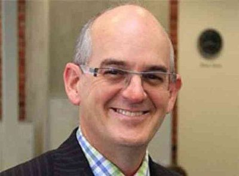

# Tony Ryall

| | |
|---|---|
| **Party** | New Zealand National Party |
| **Status** | Former MP |
| **Now (Oct 2026)** | Retired from Parliament at the 2014 election. Chief executive of early-childhood provider BestStart Educare (per Wikipedia); previously head of public policy at Simpson Grierson (2014) and director of nib NZ (2015). |
| **Electorate(s)** | East Cape (1990–1993); Eastern Bay of Plenty (1993–1996); Bay of Plenty (1996–2014) |
| **Parliaments** | 43th, 44th, 45th, 46th, 47th, 48th, 49th, 50th |
| **First elected** | 1990 |
| **Born** | 1964-11-19 — New Zealand |
| **Wikipedia** | [Tony Ryall](https://en.wikipedia.org/wiki/Tony_Ryall) |

## Current status

Former MP. He retired at the 2014 election. Wikipedia lists him as chief executive of the early-childhood provider BestStart Educare. After leaving Parliament he was head of public policy at law firm Simpson Grierson (2014) and a director of nib NZ (2015). He was made CNZM in 2015. ([Stuff](http://www.stuff.co.nz/business/industries/63087099/Former-MP-Tony-Ryall-joins-Simpson-Grierson))

## Biography

- Born 19 November 1964 in Christchurch and raised in the Eastern Bay of Plenty.
- BBS in accounting and finance from Massey University.
- Worked as a bank credit analyst, including at BNZ.
- Married with two children.

## Political career

- **Electorates:** elected for East Cape in 1990, aged 26. After boundary changes he held Eastern Bay of Plenty (1993–96) and then Bay of Plenty (1996–2014). In 2005 he had the country's largest National majority.
- **Shipley Cabinet (1997–99):**
  - State-Owned Enterprises.
  - Youth Affairs and Local Government.
  - Minister of Justice in 1999.
- **Opposition spokesperson:** law and order, among other roles.
- **Key Cabinet (2008–14):**
  - Minister of Health for the whole period.
  - Minister of State Owned Enterprises.
- **Retirement:** announced in February 2014. ([Stuff](http://www.stuff.co.nz/national/politics/9769882/Tony-Ryall-to-retire))

**Roles held:**

- Minister of Health (2008–2014)
- Minister of State Owned Enterprises (2008–2014)
- Minister of State Services (2008–2011)
- Minister of Justice (1999)
- Minister for State-Owned Enterprises; Youth Affairs; Local Government (1997–1999)
- MP for East Cape (1990–1993)
- MP for Eastern Bay of Plenty (1993–1996)
- MP for Bay of Plenty (1996–2014)

## Record & notable actions

- **Health:** introduced national health targets, such as emergency-department waiting times and elective surgery volumes, during six years of tight budgets.
- **Asset sales:** with the Finance Minister, ran the mixed-ownership share offers. These raised about NZ$4.7b from the partial sale of three power companies and Air New Zealand.
- **Conscience votes:** voted against marriage equality (2013).

**Conscience votes** (recorded third-reading votes):

| Bill | Vote |
|---|---|
| [Marriage (Definition of Marriage) Amendment Bill — third reading, 17 Apr 2013](https://en.wikipedia.org/wiki/Marriage_(Definition_of_Marriage)_Amendment_Act_2013) | against |

## Controversies

- No significant controversies are recorded in the sources consulted.

## Sources

- <http://www.stuff.co.nz/national/politics/9769882/Tony-Ryall-to-retire>
- <http://www.stuff.co.nz/business/industries/63087099/Former-MP-Tony-Ryall-joins-Simpson-Grierson>
- <http://www.scoop.co.nz/stories/BU1502/S00353/nib-appoints-tony-ryall-to-nz-board.htm>
- <https://en.wikipedia.org/wiki/Tony_Ryall>
- Photo: <https://commons.wikimedia.org/wiki/File:Tony_Ryall.jpg> — New Zealand Government — https://www.govt.nz/organisations/ministry-of-health/ (CC BY 3.0 nz)
