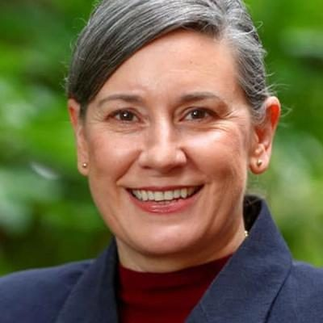

# Vanessa Weenink

| | |
|---|---|
| **Party** | New Zealand National Party |
| **Status** | Current MP — standing in 2026 |
| **Now (Oct 2026)** | Backbench MP for Banks Peninsula (since 2023); GP and former Army medical officer; #38 on National's 2026 list and re-contesting Banks Peninsula. |
| **Electorate(s)** | Banks Peninsula (2023–) |
| **Parliaments** | 54th |
| **First elected** | 2023 |
| **Born** | 1978-11-08 |
| **2026 election** | list #38, standing in Banks Peninsula |
| **Wikipedia** | [Vanessa Weenink](https://en.wikipedia.org/wiki/Vanessa_Weenink) |

> **List rank note:** policy.nz (in the 2026 candidacy section below) gives #39. The Electoral Commission's official National list gives **#38**. From #14 down, policy.nz's numbering appears to still include Chris Penk, who withdrew. ([Electoral Commission](https://vote.nz/2026-general-election/voting-in-the-election/party-lists))

## Current status

Backbench MP for Banks Peninsula since 2023. She is #38 on National's 2026 list and is re-contesting the seat.

## Biography

- **Early life:** born on 8 November 1978 in Blenheim and grew up in Canvastown.
- **Medicine:** worked as a GP for about 20 years. From 2019 she was active in medical advocacy, as deputy chair of the NZ Medical Association and chair of its GP Council, until the NZMA was wound up in 2022.
- **Military:** Army and Territorial Force medical officer for nearly 22 years, deployed twice to Afghanistan and to East Timor in 2006.
- **Party history:** previously a Labour member who campaigned with Duncan Webb in 2017. She left Labour to focus on NZMA work and joined National in 2022.
- **Personal:** married to oncologist Matthew Strother; blended family of five children.

## Political career

- **2023 selection:** missed out on the Ilam selection, then was chosen for Banks Peninsula; list #40.
- **2023 election:** beat Labour incumbent Tracey McLellan by 396 votes on the final count. It was the first time in over two decades that National had won the seat. ([Electoral Commission](https://archive.electionresults.govt.nz/electionresults_2023/electorate-details-02.html))

**Roles held:**

- MP for Banks Peninsula (2023–)
- Deputy Chair, NZ Medical Association; Chair, NZMA GP Council (c.2019–2022)

## Record & notable actions

- Described herself in her maiden speech as socially liberal and fiscally conservative.
- She was not in Parliament for the 2013–2022 conscience votes.

## Controversies

- **Smokefree (December 2023):** Newshub found 2021 Facebook comments in which she backed Labour's plan to lower nicotine levels in tobacco, which the coalition was repealing. As a backbencher she declined to comment. ([Newshub](https://www.newshub.co.nz/home/politics/2023/12/health-minister-dr-shane-reti-s-iwi-makes-public-appeal-for-him-to-stop-the-scrapping-of-smokefree-laws.html))

<!-- GENERATED:2026-candidacy START -->
## 2026 candidacy

- **Electorate:** Banks Peninsula
- **List ranking:** 39
- **Before politics:** General Practitioner
- **Residence:** St Martins
- **Age:** 47
- **Public email:** Vanessa.Weenink@National.org.nz
- **Website:** https://www.national.org.nz/team/vanessaweenink
- **Facebook:** https://www.facebook.com/VanessaWeeninkBanksPeninsula
- **Instagram:** https://www.instagram.com/vanessaweeninkbankspeninsulamp/

_Source: candidate questionnaire answers published on [policy.nz](https://policy.nz/2026/party-vote/parties/national-party), retrieved Oct 2026._
<!-- GENERATED:2026-candidacy END -->

## Sources

- <https://archive.electionresults.govt.nz/electionresults_2023/electorate-details-02.html>
- <https://thespinoff.co.nz/live-updates/03-11-2023/vanessa-weenink-extends-lead-in-banks-peninsula-tracey-mclellan-out-of-parliament>
- <https://www.newshub.co.nz/home/politics/2023/12/health-minister-dr-shane-reti-s-iwi-makes-public-appeal-for-him-to-stop-the-scrapping-of-smokefree-laws.html>
- <https://en.wikipedia.org/wiki/Vanessa_Weenink>
- <https://policy.nz/2026/party-vote/parties/national-party>
- Photo: <https://cdn.sanity.io/images/ubdwo62y/production/29bbc333f88399317d9075ada8381c853599e86f-1024x1024.jpg> — Supplied to policy.nz by the candidate/party (Not stated (candidate photo supplied to policy.nz; used for identification))
