# New Zealand First — people

Profiles of 62 people associated with New Zealand First: MPs who served in the 50th–54th Parliaments (2011–2026) and every 2026 candidate listed on policy.nz. Status is as of 23 October 2026 (election day 7 November 2026). Each person sits under their current or most recent party. Click a name for the full profile.

## Current MPs (54th Parliament) (8)

| | Name | Status | 2026 electorate | 2026 list # | Roles / notes |
|---|---|---|---|---|---|
| 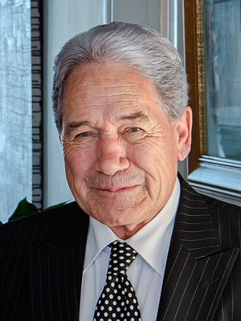 | [Winston Peters](winston-peters/README.md) | MP (54th Parliament), standing in 2026 |  | 1 | Leader of New Zealand First (1993–); Minister of Foreign Affairs (2005–2008, 2017–2020, 2023–); Deputy Prime Minister (1996–1998, 2017–2020, 2023–2025) |
|  | [Shane Jones](shane-jones/README.md) | MP (54th Parliament), standing in 2026 | Northland | 2 | Deputy Leader of NZ First (2025–); Minister for Oceans and Fisheries, Regional Development, Resources; Associate Minister of Finance and Energy (2023–); Minister for Regional Economic Development, Forestry, Infrastructure (2017–2020) |
|  | [Casey Costello](casey-costello/README.md) | MP (54th Parliament), standing in 2026 | Port Waikato | 3 | Minister of Customs (2023–); Minister for Seniors (2023–); Associate Minister of Health (tobacco/vaping), Immigration and Police (2023–) |
| 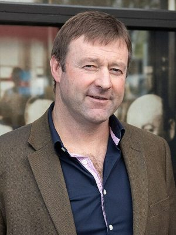 | [Mark Patterson](mark-patterson/README.md) | MP (54th Parliament), standing in 2026 | Taieri | 4 | Minister for Rural Communities (2023–); Associate Minister of Agriculture (wool) (2023–); Associate Minister for Regional Development (2024–) |
|  | [Jenny Marcroft](jenny-marcroft/README.md) | MP (54th Parliament), standing in 2026 | Kaipara ki Mahurangi | 10 | Parliamentary Under-Secretary to the Minister for Media and Communications (2023–); Parliamentary Under-Secretary to the Minister for Oceans and Fisheries (2024–); NZ First spokesperson on health, ACC, arts, broadcasting, conservation, environment (2017–2020) |
| 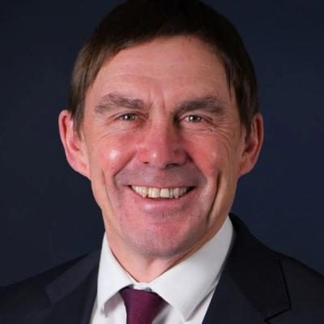 | [Andy Foster](andy-foster/README.md) | MP (54th Parliament), standing in 2026 | Remutaka | 11 | Mayor of Wellington (2019–2022); Wellington City Councillor (1992–2019); President (now life member), TRAFINZ |
| 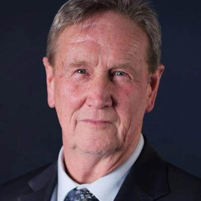 | [David Wilson](david-wilson/README.md) | MP (54th Parliament), standing in 2026 | Henderson | 12 | Member, Economic Development, Science and Innovation Committee; Finance and Expenditure Committee; CEO, Northland Inc (2013–2017, to 2019); Chair, Economic Development Association of NZ |
| 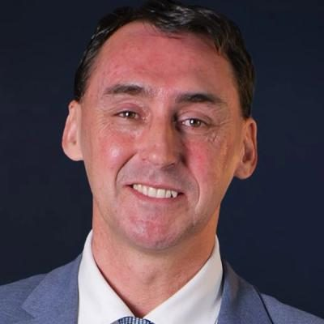 | [Jamie Arbuckle](jamie-arbuckle/README.md) | MP (54th Parliament), standing in 2026 | Kaikōura | 13 | NZ First whip (2023–); Deputy chair, Justice Committee; Marlborough District Councillor (2010–2024) |

## 2026 candidates (41)

| | Name | Status | 2026 electorate | 2026 list # | Roles / notes |
|---|---|---|---|---|---|
| 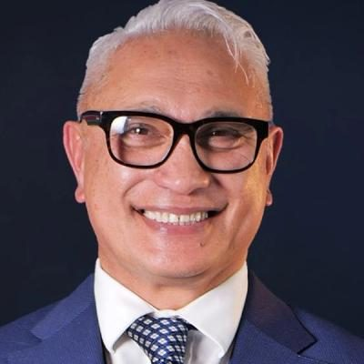 | [Alfred Ngaro](alfred-ngaro/README.md) | 2026 candidate | Glendene | 5 | Minister for Pacific Peoples (2016–2017); Minister for the Community and Voluntary Sector (2016–2017); Associate Minister for Children and for Social Housing (2016–2017) |
| 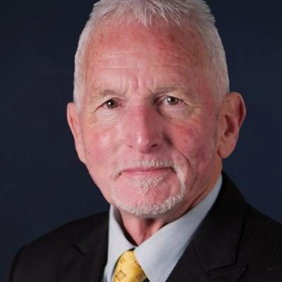 | [Michael Laws](michael-laws/README.md) | 2026 candidate | Waitaki | 6 | MP for Hawke's Bay (1990–1996); Mayor of Whanganui (2004–2010); Otago Regional Councillor (2016–; deputy chair until 2022) |
|  | [Harete Hipango](harete-hipango-brownlie/README.md) | 2026 candidate | Whanganui | 7 | MP for Whanganui (2017–2020); National list MP (2021–2023); Member, Māori Affairs Committee |
| 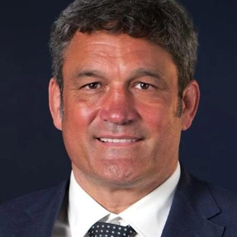 | [Taine Randell](taine-randell/README.md) | 2026 candidate | Tukituki | 9 | All Blacks captain (1998–1999, 2002); Director, Kahungunu Asset Holding Company (from 2010) |
|  | [Ron Mark](ron-mark/README.md) | 2026 candidate | Wairarapa | 16 | Minister of Defence (2017–2020); Minister for Veterans (2017–2020); Deputy Leader of NZ First (2015–2018) |
| 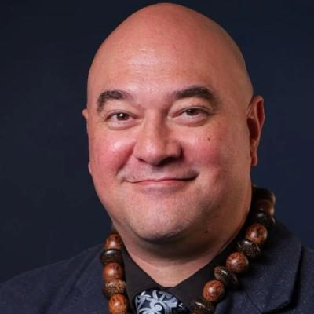 | [Elliot Ikilei](elliot-ikilei/README.md) | 2026 candidate | Takanini | 20 | Deputy leader, (New) Conservative Party (2017–2020); Leader, New Conservative (Nov–Dec 2020); Youth worker |
| 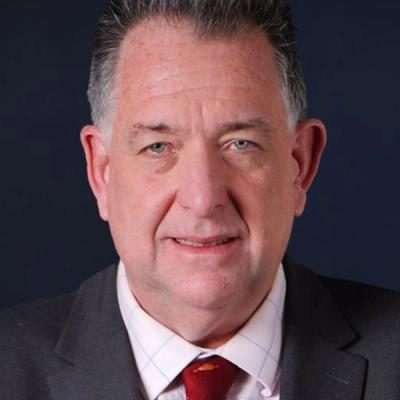 | [Alistair Boyce](alistair-boyce/README.md) | 2026 candidate | Hutt South |  | Before politics: Managing Director |
|  | [Bernadette Soares](bernadette-soares/README.md) | 2026 candidate | Upper Harbour |  | Before politics: Business Owner and Director |
| 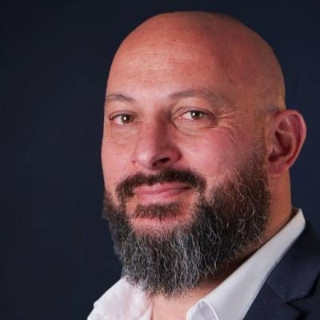 | [Billy Brown](billy-brown/README.md) | 2026 candidate | Rotorua |  |  |
|  | [Bryce Park](bryce-park/README.md) | 2026 candidate | Wigram |  | Before politics: Financial Analyst ex Dishie |
| 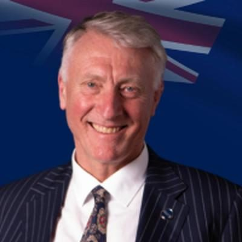 | [Craig Stobo](craig-stobo/README.md) | 2026 candidate | Botany |  |  |
| 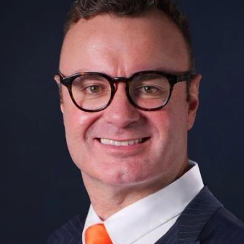 | [Daryl Habraken](daryl-habraken/README.md) | 2026 candidate | Northcote |  | Before politics: Commercial Director |
| 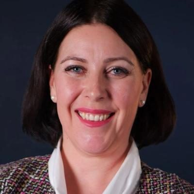 | [Elizabeth Mundt](elizabeth-mundt/README.md) | 2026 candidate | Selwyn |  | Before politics: School assistant |
|  | [Esther Tofilau-Tevaga](esther-tofilau-tevaga/README.md) | 2026 candidate | Manurewa |  | Before politics: Volunteer and a business owner |
|  | [Gerald Warner](gerald-warner/README.md) | 2026 candidate | Wellington Bays |  |  |
|  | [Isaac Nicholson](isaac-nicholson/README.md) | 2026 candidate | Rangitata |  | Before politics: Plumber, Gasfitter, Drainlayer |
|  | [Jackie Farrelly](jackie-farrelly/README.md) | 2026 candidate | Waimakariri |  | Before politics: Tourism Business Owner |
|  | [Jamie Cleine](jamie-cleine/README.md) | 2026 candidate | West Coast-Tasman |  | Before politics: Mayor of Buller District. |
|  | [Jason Herrick](jason-herrick/README.md) | 2026 candidate | Southland |  | Before politics: "Dairy farmer", |
|  | [John Stringer](john-stringer/README.md) | 2026 candidate | Banks Peninsula |  |  |
| 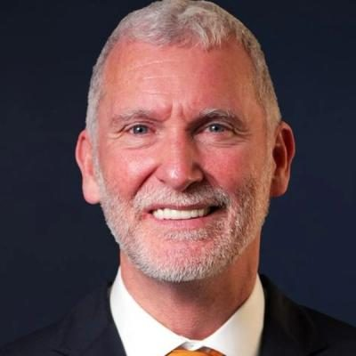 | [Jon Blackshaw](jon-blackshaw/README.md) | 2026 candidate | Kenepuru |  | Before politics: Registered Social Worker |
|  | [Keegan Langeveld](keegan-langeveld/README.md) | 2026 candidate | Maungakiekie |  | Before politics: Communications Advisor |
| 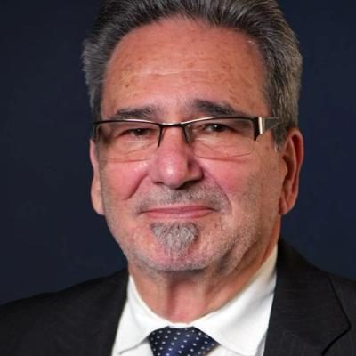 | [Kevin Stone](kevin-stone/README.md) | 2026 candidate | Hamilton West |  |  |
|  | [Kym McDonald-King](kym-mcdonald-king/README.md) | 2026 candidate | Dunedin |  | Before politics: Parliamentary Outreach Advisor |
| 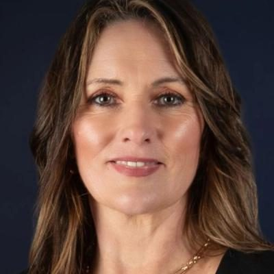 | [Lee Smith](lee-smith/README.md) | 2026 candidate | Taranaki-King Country |  | Before politics: Current Small Business Owner |
| 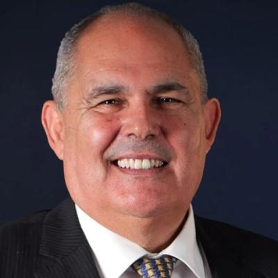 | [Mark Arneil](mark-arneil/README.md) | 2026 candidate | Christchurch Central |  | Before politics: Digital Business Partner |
|  | [Martin Gummer](martin-gummer/README.md) | 2026 candidate | Epsom |  | Before politics: Company managing director |
| 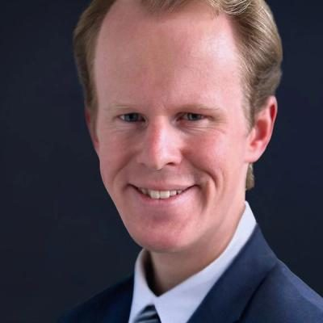 | [Nathan Walton](nathan-walton/README.md) | 2026 candidate | Ilam |  |  |
| 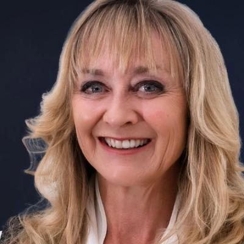 | [Nicola Laboyrie](nicola-laboyrie/README.md) | 2026 candidate | Hamilton East |  | Before politics: Self employed |
|  | [Penny Gaylor](penny-gaylor/README.md) | 2026 candidate | Kapiti |  | Before politics: Councillor GWRC Kapiti Ward |
| 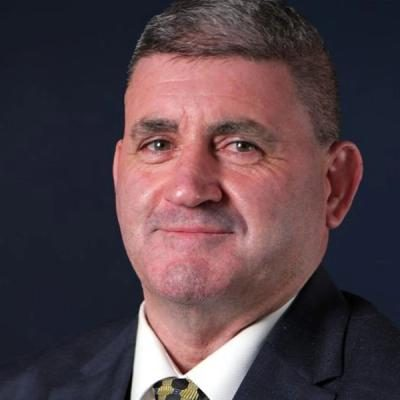 | [Robert John COOKSON](robert-john-cookson/README.md) | 2026 candidate | Waikato |  |  |
|  | [Shane Wiremu](shane-wiremu/README.md) | 2026 candidate | Christchurch East |  | Before politics: Operations Manager |
|  | [Sheldon Eden-Whaitiri](sheldon-eden-whaitiri/README.md) | 2026 candidate | Mt Albert |  | Before politics: NZME Media Specialist |
| 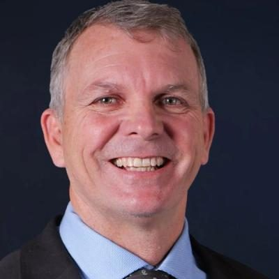 | [Steve Gibson](steve-gibson/README.md) | 2026 candidate | Rangitīkei |  | Before politics: N/A |
|  | [Taylor Arneil](taylor-arneil/README.md) | 2026 candidate | Wellington North |  | Before politics: Contractor and lifeguard |
|  | [Te Kira Lawrence](te-kira-lawrence/README.md) | 2026 candidate | Napier |  | Before politics: Outreach Advisor & Councillor |
|  | [Tracey Coxhead](tracey-coxhead/README.md) | 2026 candidate | Mt Maunganui |  | Before politics: Councillor/Business owner |
|  | [Vaughan Taylor](vaughan-taylor/README.md) | 2026 candidate | East Coast Bays |  | Before politics: Prosecution Officer |
|  | [Vicky Hau](vicky-hau/README.md) | 2026 candidate | Māngere |  | Before politics: BID Manager |
|  | [Vince Cocurullo](vince-cocurullo/README.md) | 2026 candidate | Whangārei |  | Before politics: Business owner & former Mayor |
| 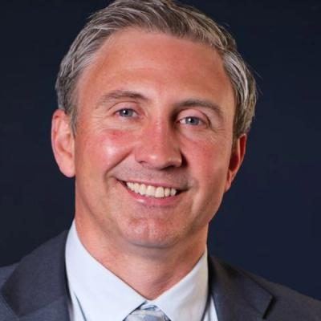 | [Vincent ANDERSEN](vincent-andersen/README.md) | 2026 candidate | Coromandel |  |  |

## Former MPs (13)

| | Name | Status | 2026 electorate | 2026 list # | Roles / notes |
|---|---|---|---|---|---|
| 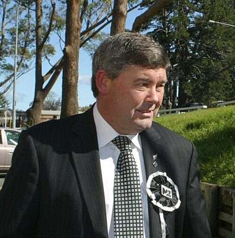 | [Andrew Williams](andrew-williams/README.md) | Former MP |  |  | Mayor of North Shore City (2007–2010); North Shore City Councillor (2001–2004) — One-term NZ First list MP (2011–2014); left off the 2014 list and retired to Taupō |
| 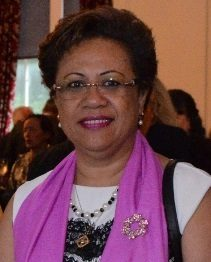 | [Asenati Lole-Taylor](asenati-lole-taylor/README.md) | Former MP |  |  | NZ First spokesperson on corrections, ethnic affairs, Pacific Island affairs, social welfare (2012–2014) — Lost her seat in 2014 after demotion to #16 on the list; left New Zealand in 2015 during an investigation into her and her husband's access to Corrections records |
|  | [Barbara Stewart](barbara-stewart/README.md) | Deceased |  |  | NZ First whip (2011–2017); NZ First spokesperson on health, ACC, disability, family, labour, tourism — Retired at the 2017 election after the death of her husband; died 2 June 2024. |
|  | [Clayton Mitchell](clayton-mitchell/README.md) | Former MP |  |  | NZ First whip; Tauranga City Councillor (2013–2014); Chair, Waikato-Bay of Plenty Hospitality Association — Retired at the 2020 election; no longer a NZ First member as of 2022 |
|  | [Darroch Ball](darroch-ball/README.md) | Party official |  |  | Chief of staff to Winston Peters (2023–); Interim President of NZ First (2020–2021); Chair, Transport and Infrastructure Committee (2017–2020) — Chief of staff to NZ First leader Winston Peters since the 2023 election (also his 2023 campaign manager) |
| 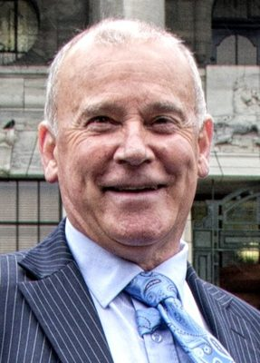 | [Denis O'Rourke](denis-orourke/README.md) | Former MP |  |  | Christchurch City Councillor (1989–2004); Chair, CCC Sustainable Transport and Utilities Committee; NZ First spokesperson (transport, local government and others) — Lost his seat in 2017 after being moved to #13 on the list; unsuccessful NZ First candidate for Banks Peninsula in 2020 |
| 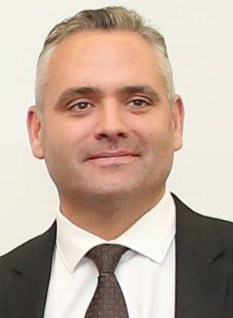 | [Fletcher Tabuteau](fletcher-tabuteau/README.md) | Former MP |  |  | Deputy Leader of NZ First (2018–2020); Parliamentary Under-Secretary for Foreign Affairs, Regional Economic Development, and Disarmament and Arms Control (2017–2020); Deputy chair, Finance and Expenditure Committee — Lost his seat in 2020; remains associated with NZ First (e.g |
|  | [Mahesh Bindra](mahesh-bindra/README.md) | Former MP |  |  | NZ First spokesperson on customs, ethnic affairs and corrections (2014–2017); Member, Law and Order Committee — One-term NZ First list MP (2014–2017); NZ First candidate for Hutt South in 2020; withdrew as Panmure-Ōtāhuhu candidate in September 2023 |
| 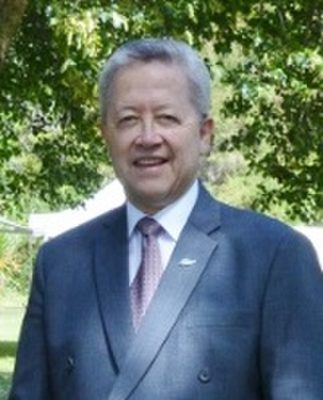 | [Pita Paraone](pita-paraone/README.md) | Deceased |  |  | Chair, Waitangi National Trust Board (2009–); Chair, Local Government Commission (2018–2019); NZ First spokesperson on Māori affairs, Treaty issues, Pacific affairs (2014–2017) — Not returned in 2017; chair of the Local Government Commission from November 2018 until his death on 26 August 2019. |
|  | [Ria Bond](ria-bond/README.md) | Former MP |  |  | Invercargill City Councillor (2022–); President, NZ Association of Registered Hairdressers (2006–2012); Member, Commerce Committee (2015–2017) — Former NZ First list MP (2015–2017); Invercargill City Councillor since 2022 (re-elected 2025; unsuccessful mayoral candidate 2022 and 2025) |
|  | [Richard Prosser](richard-prosser/README.md) | Deceased |  |  | NZ First spokesperson on agriculture, fisheries, forestry, police; Columnist, Investigate magazine — Lost his seat in 2017 after being demoted on the list; died 10 June 2022. |
| 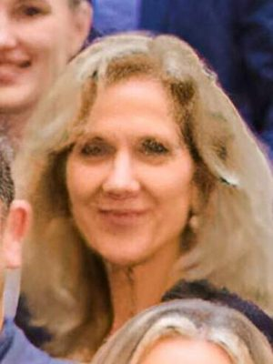 | [Tanya Unkovich](tanya-unkovich/README.md) | Former MP |  |  | Host of NZ First podcast FirstHand (2023–) — Resigned from Parliament on 27 June 2025 to concentrate on private-sector work (replaced by David Wilson) |
| 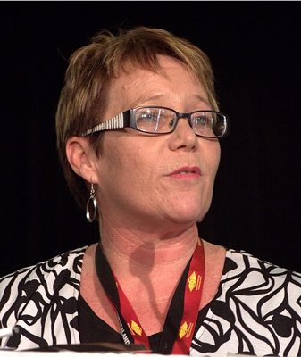 | [Tracey Martin](tracey-martin/README.md) | Former MP |  |  | Minister for Children (2017–2020); Minister of Internal Affairs (2017–2020); Minister for Seniors (2017–2020) — Lost her seat in 2020 and left NZ First in January 2021; has since said she is politically closer to Labour |

_Built by `tools/people_others_index.py` from each profile's `person.json`. Candidate details come from policy.nz; MP histories from Wikipedia and the sources cited in each profile._
