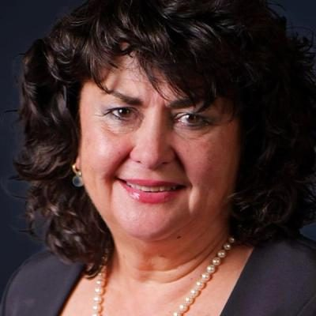

# Casey Costello

| | |
|---|---|
| **Party (current/most recent)** | New Zealand First |
| **Status** | MP (54th Parliament), standing in 2026 |
| **Party history** | act (candidate) (2011–2011); new-conservative (board) (2019–2019); New Zealand First (2022–present) |
| **Parliaments (50th–54th)** | 54 |
| **First elected** | 2023 |
| **Key roles** | Minister of Customs (2023–) Minister for Seniors (2023–) Associate Minister of Health (tobacco/vaping), Immigration and Police (2023–) Founding trustee and spokesperson, Hobson's Pledge (2016–) Board chair, NZ Taxpayers' Union Vice-president, NZ Police Association |
| **Born** | 1965 or 1966 |
| **2026 election** | contesting Port Waikato, list #3 |
| **Wikipedia** | [Casey Costello](https://en.wikipedia.org/wiki/Casey_Costello) |

Photo: Supplied to policy.nz by the candidate/party — [source](https://cdn.sanity.io/images/ubdwo62y/production/c6213e1ce1871680c2b3a977c12666833cd0bbf6-1024x1024.jpg)

## Current status

NZ First list MP since 2023 and minister outside Cabinet (Customs; Seniors; Associate Health, Immigration, Police). Standing in **Port Waikato** and **#3** on NZ First's list for 2026.

## Biography

Cassandra Jane "Casey" Costello (born 1965 or 1966) is the daughter of racing journalist John Costello and tennis representative Maryann Davis; of Māori (Ngātiwai, Ngāti Hau, Ngāpuhi), Scottish and Irish descent, and related to Kelvin Davis and Hone Harawira. Educated at Marcellin College; worked as a reporter, then joined the Police in 1986 for 14 years (including the 1992 Schlaepfer murders) and became the first woman vice-president of the Police Association. Later Parliament's manager of security and operations, and a building-services manager. A founding trustee and spokesperson for Hobson's Pledge (with Don Brash), which opposes Treaty "partnership", and board chair of the Taxpayers' Union.

## Political career

- ACT candidate for Māngere in 2011; on the New Conservative board in 2019; joined NZ First in 2022.
- Elected at list #3 in 2023; second in the 25 November 2023 Port Waikato by-election (2,864 votes).
- Minister from November 2023.

## Record & notable actions

- **Smokefree repeal**: steered repeal (under urgency, February 2024) of Labour's generational tobacco ban, retailer reduction and denicotinisation; introduced a ban on disposable vapes and higher fines (up to $100,000) for selling vapes to minors; halved excise on heated tobacco products for a trial (July 2024), which the Ministry of Health said had no evidence base.
- Repeal of the Therapeutic Products Act 2023 (December 2024).
- Directed Health NZ (March 2025) to use "clear language" such as "women" rather than "pregnant people".
- Customs: $35m (2025) against drug smuggling; $70m (2026) for underwater drones. Made the community refugee sponsorship scheme permanent and expanded (2026).
- Set up an advisory group on transnational organised crime (2025).

## Controversies

- **Tobacco policy and industry influence (2024–25):** a proposed three-year freeze on tobacco excise was traced to her office, with notes claiming "Nicotine is as harmful as caffeine"; PM Luxon said she had made a mistake and the freeze did not proceed. The Chief Ombudsman ruled in July 2024 that she unlawfully withheld OIA information from RNZ and Prof. Janet Hoek and ordered an apology, and in September 2024 criticised her handling of a "mystery document" of industry-friendly ideas. New Zealand fell from 2nd to 53rd in the 2025 Global Tobacco Industry Interference Index, which she called "ludicrous". She denies any tobacco-industry links.
- Labour called her "missing in action" as Seniors Minister (2025); she rejected this.
- Her Hobson's Pledge advocacy describing Māori-specific redress as "racist and separatist" is contentious.

<!-- GENERATED:2026-candidacy START -->
## 2026 candidacy

- **Electorate:** Port Waikato
- **Before politics:** Management
- **Age:** 60
- **Public email:** casey.costello@nzfirst.nz
- **Website:** www.nzfirst.nz
- **Facebook:** https://www.facebook.com/caseycostellonzfirst/
- **Instagram:** https://www.instagram.com/caseycostellomp/

_Source: candidate questionnaire answers published on [policy.nz](https://policy.nz/2026/party-vote/parties/nz-first), retrieved Oct 2026._
<!-- GENERATED:2026-candidacy END -->

## Sources

- https://en.wikipedia.org/w/index.php?title=Casey_Costello&oldid=1381287535
- https://en.wikipedia.org/wiki/Party_lists_in_the_2026_New_Zealand_general_election
- https://www.nzherald.co.nz/nz/politics/casey-costello-what-drives-nz-first-new-mp-and-port-waikato-byelection-candidate/COQORARWORAE7PVYDEFS3TY5RQ/
- https://www.hobsonspledge.nz/about_us
- https://globaltobaccoindex.org/gti/2025
- https://policy.nz/2026/party-vote/parties/nz-first
