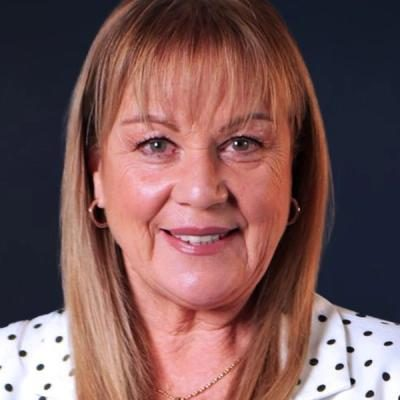

# Jenny Marcroft

| | |
|---|---|
| **Party (current/most recent)** | New Zealand First |
| **Status** | MP (54th Parliament), standing in 2026 |
| **Party history** | New Zealand First (by 2017–2021-01); Labour (2021–2022); New Zealand First (2022–present) |
| **Parliaments (50th–54th)** | 52, 54 |
| **First elected** | 2017 |
| **Key roles** | Parliamentary Under-Secretary to the Minister for Media and Communications (2023–) Parliamentary Under-Secretary to the Minister for Oceans and Fisheries (2024–) NZ First spokesperson on health, ACC, arts, broadcasting, conservation, environment (2017–2020) |
| **Born** | 1963 |
| **2026 election** | contesting Kaipara ki Mahurangi, list #10 |
| **Wikipedia** | [Jenny Marcroft](https://en.wikipedia.org/wiki/Jenny_Marcroft) |

Photo: Supplied to policy.nz by the candidate/party — [source](https://cdn.sanity.io/images/ubdwo62y/production/192fe683571c6633b1f2378f54e9cab1dc07efc9-1024x1024.jpg)

## Current status

NZ First list MP (2017–2020, 2023–) and Parliamentary Under-Secretary for Media and Communications and for Oceans and Fisheries. Standing in **Kaipara ki Mahurangi** and **#10** on NZ First's list for 2026.

## Biography

Born 1963; orphaned at 16 and later ran away from a violent stepfather in Rotorua. Part Māori (Ngāpuhi) on her father's side. A broadcaster for more than 30 years, mainly as a radio newsreader for Independent Radio News and occasionally on TV3; known for insisting on correct pronunciation of Māori names and saying "kia ora" on air in the 1990s despite instructions not to. After 2022 she worked as an adviser to Auckland Mayor Wayne Brown.

## Political career

- Elected at list #9 in 2017; lost her seat in 2020.
- Left NZ First in January 2021 with Tracey Martin and joined Labour, but was back with NZ First by October 2022.
- Re-elected at list #5 in 2023 (fourth in Kaipara ki Mahurangi).

## Record & notable actions

- Secured the 2019 amendment (passed 63–57) making the End of Life Choice Act conditional on a binding referendum.
- Announced NZ First's 2023 policy to increase Pharmac's budget by $1.3 billion.
- **Legislation (Definitions of Woman and Man) Amendment Bill** (drawn April 2026): defines a woman as an "adult human biological female" and a man as an "adult human biological male"; passed first reading on 20 May 2026. Supported by Family First; lawyers called it unnecessary and the Greens said it harmed transgender people; the Justice Minister said it was not a government priority.
- Received the 90,000-signature petition for a ban on public fireworks sales (2025).

## Controversies

- Her sex-definition bill is contested (see above).

<!-- GENERATED:2026-candidacy START -->
## 2026 candidacy

- **Electorate:** Kaipara ki Mahurangi

_Source: candidate questionnaire answers published on [policy.nz](https://policy.nz/2026/party-vote/parties/nz-first), retrieved Oct 2026._
<!-- GENERATED:2026-candidacy END -->

## Sources

- https://en.wikipedia.org/w/index.php?title=Jenny_Marcroft&oldid=1358424712
- https://en.wikipedia.org/wiki/Party_lists_in_the_2026_New_Zealand_general_election
- https://policy.nz/2026/party-vote/parties/nz-first
