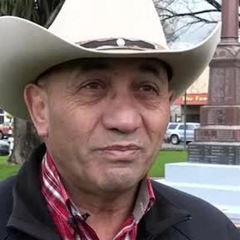

# Ron Mark

| | |
|---|---|
| **Party (current/most recent)** | New Zealand First |
| **Status** | 2026 candidate |
| **Party history** | Labour (1990–1993); New Zealand First (1996–2021 (membership lapsed)); New Zealand First (2026–present) |
| **Parliaments (50th–54th)** | 51, 52 |
| **First elected** | 1996 |
| **Key roles** | Minister of Defence (2017–2020) Minister for Veterans (2017–2020) Deputy Leader of NZ First (2015–2018) Mayor of Carterton (2010–2014, 2022–2025) Senior Government Whip (1996–1998) Member, Waitangi Tribunal (2025–) |
| **Born** | 1954-01-29, Masterton |
| **2026 election** | contesting Wairarapa, list #16 |
| **Wikipedia** | [Ron Mark](https://en.wikipedia.org/wiki/Ron_Mark) |

Photo: Supplied to policy.nz by the candidate/party — [source](https://cdn.sanity.io/images/ubdwo62y/production/a74ffb80646ace932243656b22826e463d7a4d0f-1024x1024.jpg)

## Current status

Former MP (1996–2008, 2014–2020) and former Minister of Defence. NZ First confirmed in August 2026 that he would stand again; he is NZ First's candidate for **Wairarapa** and **#16** on the list. He was Mayor of Carterton from 2022 until October 2025 and was appointed to the Waitangi Tribunal in January 2025.

## Biography

Born in Masterton on 29 January 1954 (Ngāti Kahungunu); raised by six Pākehā foster families in Pahiatua and educated at Tararua College. Served in the New Zealand Army 1971–1990 (including a 1982–83 Sinai tour with the Multinational Force and Observers), then as an officer in the Sultan of Oman's Special Force (1986–1990). Later a commercial consultant, importer/exporter and amusement-park operator. Former MP Marama Fox is a cousin. In 2022 he travelled to Ukraine to help with humanitarian efforts.

## Political career

- Labour candidate for Selwyn in 1993; joined NZ First and was a list MP 1996–2008 (Senior Government Whip 1996–98).
- Mayor of Carterton 2010–2014.
- Returned to Parliament in 2014 (list #9); runner-up for Speaker in 2014; NZ First deputy leader from July 2015 to February 2018.
- Minister of Defence and Veterans 2017–2020; lost his seat in 2020. Said in 2021 he was finished with politics and let his membership lapse, before returning as a candidate in 2026.

## Record & notable actions

- Minister of Defence and Veterans for the full 2017–2020 term (details of procurement decisions are not covered in the sources consulted here).
- As Carterton mayor (2022–25) opposed Three Waters "centralisation" but in 2024 urged councils to consider amalgamation because of Local Water Done Well costs.

## Controversies

- TV3 was banned from filming in Parliament for three days in 2006 after broadcasting him repeatedly giving the finger to another MP.
- In November 2015 he told National MP Melissa Lee to "go back to Korea" in Parliament.

<!-- GENERATED:2026-candidacy START -->
## 2026 candidacy

- **Electorate:** Wairarapa

_Source: candidate questionnaire answers published on [policy.nz](https://policy.nz/2026/party-vote/parties/nz-first), retrieved Oct 2026._
<!-- GENERATED:2026-candidacy END -->

## Sources

- https://en.wikipedia.org/w/index.php?title=Ron_Mark&oldid=1380657620
- https://en.wikipedia.org/wiki/Party_lists_in_the_2026_New_Zealand_general_election
- https://policy.nz/2026/party-vote/parties/nz-first
