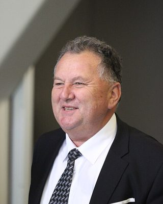

# Shane Jones

| | |
|---|---|
| **Party (current/most recent)** | New Zealand First |
| **Status** | MP (54th Parliament), standing in 2026 |
| **Party history** | Labour (2005–2014); New Zealand First (2017–present) |
| **Parliaments (50th–54th)** | 50, 52, 54 |
| **First elected** | 2005 |
| **Key roles** | Deputy Leader of NZ First (2025–) Minister for Oceans and Fisheries, Regional Development, Resources; Associate Minister of Finance and Energy (2023–) Minister for Regional Economic Development, Forestry, Infrastructure (2017–2020) Minister for Building and Construction (2007–2008, Labour) Pacific Economic Ambassador (2014–2017) Chair, Treaty of Waitangi Fisheries Commission (2000–2004) |
| **Born** | 1959-09-03, Awanui |
| **2026 election** | contesting Northland, list #2 |
| **Wikipedia** | [Shane Jones](https://en.wikipedia.org/wiki/Shane_Jones) |

Photo: Stuartyeates — CC BY-SA 4.0 — [source](https://commons.wikimedia.org/wiki/File:Shane_Jones_2018_5.jpg)

## Current status

Deputy leader of NZ First (elected by caucus on 17 September 2025), list MP and minister outside Cabinet (Oceans and Fisheries; Regional Development; Resources; Associate Finance and Energy). Standing in **Northland** and **#2** on NZ First's list for 2026.

## Biography

Born at Awanui near Kaitaia on 3 September 1959 (Te Aupōuri, Ngāi Takoto; also English, Welsh and Croatian ancestry). Educated at St Stephen's School and Victoria University of Wellington (BA); Harkness Fellow and MPA from Harvard Kennedy School (1990). Fluent in te reo Māori. A public servant advising on Treaty settlements in the 1980s, then a member and from 2000 chair of the Treaty of Waitangi Fisheries Commission, completing the allocation of fisheries assets to iwi (2004); chaired Sealord.

## Political career

- **Labour 2005–2014**: list MP; chair of Finance and Expenditure Committee; Minister for Building and Construction from October 2007. Contested the 2013 Labour leadership (won 7 of 34 caucus votes). Resigned in May 2014 to become Pacific Economic Ambassador (replaced by Kelvin Davis).
- **NZ First 2017–2020**: elected at list #8; Minister for Regional Economic Development (the $3 billion Provincial Growth Fund), Forestry and Infrastructure. Lost Northland in 2020 when NZ First was ousted.
- **NZ First 2023–**: list #2; minister in the National-led coalition; deputy leader from September 2025.

## Record & notable actions

- **Provincial Growth Fund (2018–2020)**: distributed grants to regional rail, ports and industry (e.g. Hillside Engineering); National called it a "slush fund" and questioned links between some applicants and NZ First.
- "One billion trees" forestry policy (2017–2020).
- **Crown Minerals Amendment Act 2025**: reversed Labour's 2018 ban on new offshore oil and gas exploration permits (passed July 2025).
- Halted the Kermadec Ocean Sanctuary legislation (2024); promoted aquaculture; quota system changes exempting fishing-vessel camera footage from the OIA (2025); his Fisheries Amendment Bill's plan to scrap size limits for commercial catch was dropped after pressure from the PM and Peters, and the bill was deferred until after the election.
- Involved in critical-minerals talks with the US (Minerals Security Partnership); funded diesel storage at Marsden Point (2026).
- Voted for marriage equality (2013) and the End of Life Choice Act.

## Controversies

- **Ministerial credit card (2010)**: admitted using a Crown card for personal spending, including hotel pornographic films; repaid and was demoted by Phil Goff.
- **William Yan citizenship (2008/2012)**: granted citizenship to the Labour donor against officials' advice; the Auditor-General found no improper motive or political interference.
- **Remarks on immigrants**: anti-Indian remarks in 2019–2020 that the Race Relations Commissioner called "racist, ignorant and harmful"; shouted "Send the Mexicans home!" in Parliament in January 2025 (the Mexican Embassy raised concerns); in 2025 complained that "Singh" and "Patel" were among the most common baby names.
- **Travel spending (2026)**: sought retrospective Cabinet approval for an extra $33,068 after a February 2025 Canada mining-convention trip cost about $63,000 (including a limousine and business-class flights); Finance Minister Nicola Willis said he made "significant errors".
- Described protesting farmers as "rednecks" (2019) and climate activists as "medieval torture chamber workers" (2020); ejected from the House in 2019.

<!-- GENERATED:2026-candidacy START -->
## 2026 candidacy

- **Electorate:** Northland

_Source: candidate questionnaire answers published on [policy.nz](https://policy.nz/2026/party-vote/parties/nz-first), retrieved Oct 2026._
<!-- GENERATED:2026-candidacy END -->

## Sources

- https://en.wikipedia.org/w/index.php?title=Shane_Jones&oldid=1380808556
- https://en.wikipedia.org/wiki/Party_lists_in_the_2026_New_Zealand_general_election
- https://www.rnz.co.nz/news/political/503156/cabinet-lineup-for-new-government-unveiled-who-gets-what
- https://www.nzherald.co.nz/nz/politics/trade-minister-todd-mcclay-apologises-to-green-mp-ricardo-menndez-march-over-remarks-allegedly-referencing-mexico/QL24DQECPREDVMDQJMPV2FSL7Y/
- https://policy.nz/2026/party-vote/parties/nz-first
