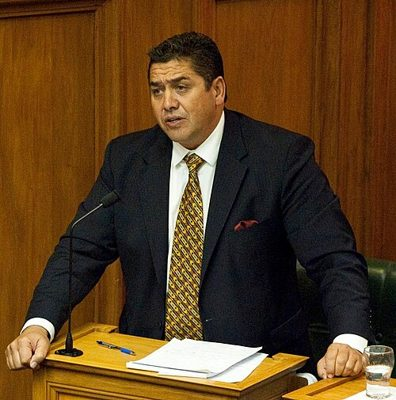

# NZ Independent Coalition — people

Profiles of 1 people associated with NZ Independent Coalition: MPs who served in the 50th–54th Parliaments (2011–2026) and every 2026 candidate listed on policy.nz. Status is as of 23 October 2026 (election day 7 November 2026). Each person sits under their current or most recent party. Click a name for the full profile.

## Former MPs (1)

| | Name | Status | 2026 electorate | 2026 list # | Roles / notes |
|---|---|---|---|---|---|
|  | [Brendan Horan](brendan-horan/README.md) | Former MP |  |  | NZ First list MP (2011–2012), then independent (2012–2014); Founder, NZ Independent Coalition (2014); TVNZ One News weather presenter (2005–2007) — Lost his seat in 2014; his NZ Independent Coalition party was deregistered in 2016 |

_Built by `tools/people_others_index.py` from each profile's `person.json`. Candidate details come from policy.nz; MP histories from Wikipedia and the sources cited in each profile._
