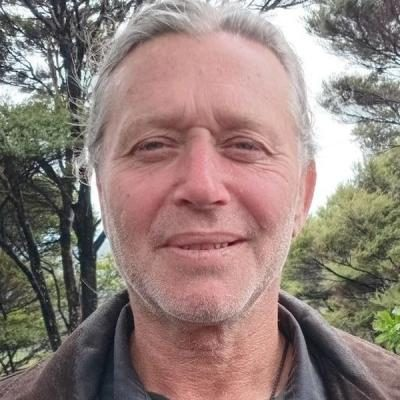
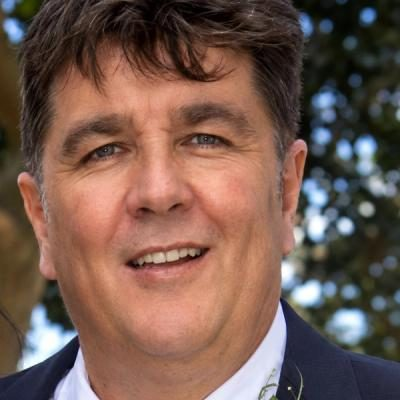
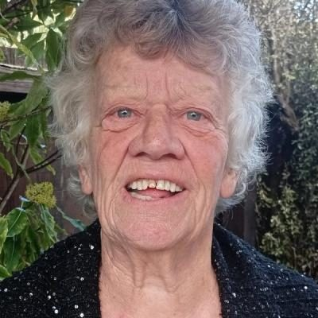
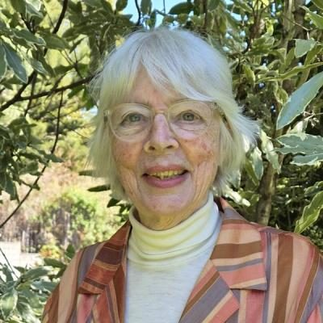
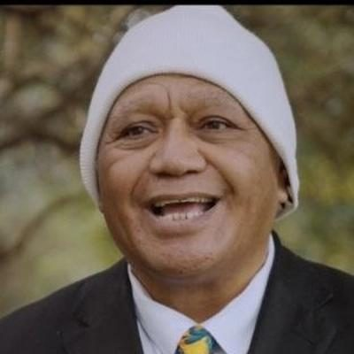

# New Zealand Loyal — people

Profiles of 16 people associated with New Zealand Loyal: MPs who served in the 50th–54th Parliaments (2011–2026) and every 2026 candidate listed on policy.nz. Status is as of 23 October 2026 (election day 7 November 2026). Each person sits under their current or most recent party. Click a name for the full profile.

## 2026 candidates (16)

| | Name | Status | 2026 electorate | 2026 list # | Roles / notes |
|---|---|---|---|---|---|
|  | [Kelvyn Alp](kelvyn-alp/README.md) | 2026 candidate | Māngere | 1 | Leader, New Zealand Loyal (2024–); Director and host, Counterspin Media; Founder, NZ Armed Intervention Force (1996) |
|  | [Alexander Hislop](alexander-hislop/README.md) | 2026 candidate | West Coast-Tasman |  | Before politics: Businessman |
|  | [Allan Lind](allan-lind/README.md) | 2026 candidate | East Coast Bays |  |  |
|  | [Barak Ford](barak-ford/README.md) | 2026 candidate | Northcote |  |  |
|  | [Brenton Bruce FAITHFULL](brenton-bruce-faithfull/README.md) | 2026 candidate | Whangaparāoa |  |  |
|  | [Christine Fisher](christine-fisher/README.md) | 2026 candidate | Te Tai Tonga |  |  |
|  | [Collin Blackman](collin-blackman/README.md) | 2026 candidate | Whangārei |  |  |
|  | [Glenn Thompson](glenn-thompson/README.md) | 2026 candidate | Christchurch East |  |  |
|  | [Gordon Wilson](gordon-wilson/README.md) | 2026 candidate | Taupō |  |  |
|  | [Greer Young](greer-young/README.md) | 2026 candidate | Mt Maunganui |  |  |
|  | [Jason Michael Smith](jason-michael-smith/README.md) | 2026 candidate | Rangitīkei |  |  |
|  | [John Alcock](john-alcock/README.md) | 2026 candidate | Ōtāhuhu |  |  |
|  | [Julian Crawford](julian-crawford/README.md) | 2026 candidate | Nelson |  |  |
|  | [Lesley Sales](lesley-sales/README.md) | 2026 candidate | Banks Peninsula |  |  |
|  | [Paul Nooroa Teio](paul-nooroa-teio/README.md) | 2026 candidate | Takanini |  |  |
|  | [Pete Verhoeven](pete-verhoeven/README.md) | 2026 candidate | Northland |  |  |

_Built by `tools/people_others_index.py` from each profile's `person.json`. Candidate details come from policy.nz; MP histories from Wikipedia and the sources cited in each profile._
