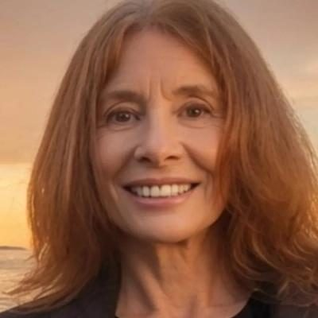
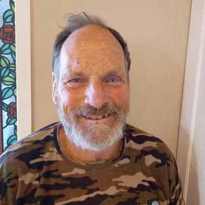
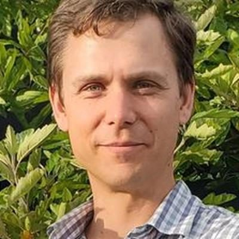
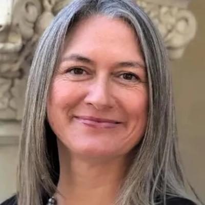

# NZ Outdoors & Freedom Party — people

Profiles of 16 people associated with NZ Outdoors & Freedom Party: MPs who served in the 50th–54th Parliaments (2011–2026) and every 2026 candidate listed on policy.nz. Status is as of 23 October 2026 (election day 7 November 2026). Each person sits under their current or most recent party. Click a name for the full profile.

## 2026 candidates (16)

| | Name | Status | 2026 electorate | 2026 list # | Roles / notes |
|---|---|---|---|---|---|
|  | [Sue Grey](sue-grey/README.md) | 2026 candidate | West Coast-Tasman | 1 | Leader/co-leader, NZ Outdoors & Freedom Party (2020–); Co-leader, Freedoms NZ (2023); Environmental and medicinal-cannabis lawyer (Nelson) |
|  | [Donna Pokere-Phillips](donna-pokere-phillips/README.md) | 2026 candidate | Hamilton West | 6 | Co-leader, NZ Outdoors & Freedom Party (2022–2025) |
|  | [Alison Pavlovich](alison-pavlovich/README.md) | 2026 candidate |  |  |  |
|  | [Alistair Wait](alistair-wait/README.md) | 2026 candidate | Northland |  | Before politics: Legal and community advocate |
|  | [Aly Cook](aly-cook/README.md) | 2026 candidate |  |  | Before politics: I am a business owner |
|  | [Barry Young](barry-young/README.md) | 2026 candidate | Wairarapa |  |  |
|  | [Bruce Dooley](bruce-dooley/README.md) | 2026 candidate |  |  | Before politics: Medical Doctor GP |
|  | [Cedric Backhouse](cedric-backhouse/README.md) | 2026 candidate | Rangitīkei |  |  |
|  | [David Mueller-Cajar](david-mueller-cajar/README.md) | 2026 candidate | Christchurch East |  |  |
|  | [Daymond Goulder-Horobin](daymond-goulder-horobin/README.md) | 2026 candidate |  |  | Before politics: Tech Entrepreneur |
|  | [Hine Afeaki](hine-afeaki/README.md) | 2026 candidate | Māngere |  |  |
|  | [Keith Upson](keith-upson/README.md) | 2026 candidate |  |  | Before politics: Manager, Director Engineering |
|  | [Kevin McCracken](kevin-mccracken/README.md) | 2026 candidate | Rangitata |  |  |
|  | [Liz Dotcom](liz-dotcom/README.md) | 2026 candidate | Kaipara ki Mahurangi |  |  |
|  | [Noah Wakelam](noah-wakelam/README.md) | 2026 candidate | Whangārei |  |  |
|  | [Ray Cobb](ray-cobb/README.md) | 2026 candidate | Coromandel |  |  |

_Built by `tools/people_others_index.py` from each profile's `person.json`. Candidate details come from policy.nz; MP histories from Wikipedia and the sources cited in each profile._
