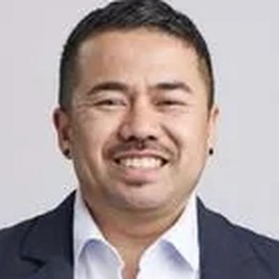
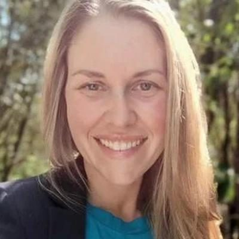
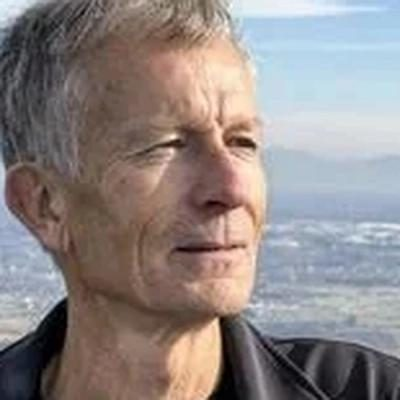

# The Opportunity Party (TOP) — people

Profiles of 42 people associated with The Opportunity Party (TOP): MPs who served in the 50th–54th Parliaments (2011–2026) and every 2026 candidate listed on policy.nz. Status is as of 23 October 2026 (election day 7 November 2026). Each person sits under their current or most recent party. Click a name for the full profile.

## 2026 candidates (42)

| | Name | Status | 2026 electorate | 2026 list # | Roles / notes |
|---|---|---|---|---|---|
|  | [Qiulae Wong](qiulae-wong/README.md) | 2026 candidate | Mt Albert | 1 | Leader, Opportunity Party (2025–); Sustainable business consultant, KPMG |
|  | [Daniel Eb](daniel-eb/README.md) | 2026 candidate | Kaipara ki Mahurangi | 2 | Before politics: Business and impact founder |
|  | [Jessica Hammond](jessica-hammond/README.md) | 2026 candidate | Wellington North | 3 | Public servant (policy); Playwright and blogger |
|  | [Kayla Kingdon-Bebb](kayla-kingdon-bebb/README.md) | 2026 candidate | Wellington Bays | 4 | Before politics: Chief Executive |
|  | [Eden Skipper](eden-skipper/README.md) | 2026 candidate | Christchurch Central | 5 | Before politics: Policy analyst |
|  | [Jodie Kuntzsch](jodie-kuntzsch/README.md) | 2026 candidate | Nelson | 6 | Before politics: Entrepreneur |
|  | [Sarah Lucas](sarah-lucas/README.md) | 2026 candidate | New Plymouth | 7 | Before politics: Business person |
|  | [David BAINBRIDGE-ZAFAR](david-bainbridge-zafar/README.md) | 2026 candidate | Dunedin | 8 | Before politics: GM - Local Government |
|  | [Holly Knill](holly-knill/README.md) | 2026 candidate | North Shore | 9 | Before politics: Executive Director |
|  | [Pāpā Wharewera](papa-wharewera/README.md) | 2026 candidate | Waiariki | 10 | Before politics: LG Councillor, small business |
|  | [Bianca Beebe](bianca-beebe/README.md) | 2026 candidate | Southland | 11 | Before politics: Chair of Fired Up Stilettos |
|  | [Romeo Tevaga](romeo-tevaga/README.md) | 2026 candidate | Upper Harbour | 12 | Before politics: Government Policy Advisor |
|  | [Ben WYLIE-VAN EERD](ben-wylie-van-eerd/README.md) | 2026 candidate | Hutt South | 13 | Before politics: Physicist |
|  | [Rachel Ward](rachel-ward/README.md) | 2026 candidate | Tukituki | 14 | Before politics: General Manager - Conservation |
|  | [Naomi Pocock](naomi-pocock/README.md) | 2026 candidate | Hamilton East | 15 | Before politics: Teaching Fellow |
|  | [Helen Tait](helen-tait/README.md) | 2026 candidate | Waitaki | 16 | Before politics: Local government management |
|  | [Cody Marsh](cody-marsh/README.md) | 2026 candidate | Northcote | 17 | Before politics: Paramedic |
|  | [Adam MacRae-Martin](adam-macrae-martin/README.md) | 2026 candidate | Ōtāhuhu | 18 | Before politics: Lead Buyer |
|  | [Mark Roach](mark-roach/README.md) | 2026 candidate | Waitākere | 19 | Before politics: Designer & Industry Consultant |
|  | [Robert Mason](robert-mason/README.md) | 2026 candidate | Kenepuru | 20 | Before politics: Secondary school teacher |
|  | [Luke Ross](luke-ross/README.md) | 2026 candidate | Remutaka | 21 | Before politics: Video Producer |
|  | [Michael Carter](michael-carter/README.md) | 2026 candidate | Tauranga | 22 | Before politics: Architectural Designer |
|  | [Derrick Paull](derrick-paull/README.md) | 2026 candidate | Maungakiekie | 23 | Before politics: Managing Director |
|  | [Matt Shepherd](matt-shepherd/README.md) | 2026 candidate | Wairarapa | 24 | Before politics: Relief School Teacher |
|  | [Ben Lane](ben-lane/README.md) | 2026 candidate | Māngere | 25 | Before politics: Tourism |
|  | [Chee-Khiang Sng](chee-khiang-sng/README.md) | 2026 candidate | Kapiti | 26 | Before politics: Journalist, Nurse, Strategist |
|  | [Finn Liley](finn-liley/README.md) | 2026 candidate | Rotorua | 27 | Before politics: Emergency Medical Call Taker |
|  | [Evan French](evan-french/README.md) | 2026 candidate | Glendene | 28 | Before politics: Student |
|  | [Jamie Attenborough](jamie-attenborough/README.md) | 2026 candidate | Mt Roskill | 29 | Before politics: Quality Manager |
|  | [Matt Harris](matt-harris/README.md) | 2026 candidate | Rangitata | 30 | Before politics: Organisational change leader |
|  | [Sacha Haskell](sacha-haskell/README.md) | 2026 candidate | Tāmaki | 31 | Before politics: General Manager Business |
|  | [Netra Ghimire](netra-ghimire/README.md) | 2026 candidate | Palmerston North | 32 | Before politics: High School Teacher |
|  | [Cail Smith](cail-smith/README.md) | 2026 candidate | East Cape | 33 | Before politics: HR and Operations Manager |
|  | [Sam Plummer](sam-plummer/README.md) | 2026 candidate | Taupō | 34 | Before politics: Small Business Owner |
|  | [Blair Smith](blair-smith/README.md) | 2026 candidate | Hamilton West | 35 | Before politics: Critical Care Paramedic |
|  | [Johan Chang](johan-chang/README.md) | 2026 candidate | Auckland Central | 36 | Before politics: Content Producer |
|  | [Almo Wong](almo-wong/README.md) | 2026 candidate | Henderson | 37 | Before politics: Delivery Manager |
|  | [Adrian Mee](adrian-mee/README.md) | 2026 candidate | Selwyn | 38 | Before politics: Medical Laboratory Scientist |
|  | [Paul Jackson](paul-jackson/README.md) | 2026 candidate | Epsom | 39 |  |
|  | [Kevin Huang](kevin-huang/README.md) | 2026 candidate | Pakuranga | 40 | Before politics: Pharmacist |
|  | [Cindie Uddstrom](cindie-uddstrom/README.md) | 2026 candidate | West Coast-Tasman |  | Before politics: Fibreglass Manufacturer |
|  | [Simon DellaBarca](simon-dellabarca/README.md) | 2026 candidate | Whangārei |  | Before politics: Bicycle Mechanic. |

_Built by `tools/people_others_index.py` from each profile's `person.json`. Candidate details come from policy.nz; MP histories from Wikipedia and the sources cited in each profile._
