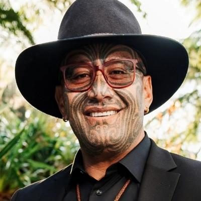
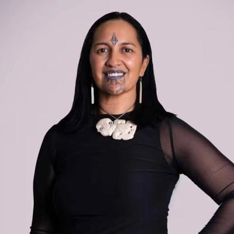

# Te Pāti Māori — people

Profiles of 13 people associated with Te Pāti Māori: MPs who served in the 50th–54th Parliaments (2011–2026) and every 2026 candidate listed on policy.nz. Status is as of 23 October 2026 (election day 7 November 2026). Each person sits under their current or most recent party. Click a name for the full profile.

## Current MPs (54th Parliament) (4)

| | Name | Status | 2026 electorate | 2026 list # | Roles / notes |
|---|---|---|---|---|---|
|  | [Debbie Ngarewa-Packer](debbie-ngarewa-packer/README.md) | MP (54th Parliament), standing in 2026 | Te Tai Hauāuru |  | Co-leader of Te Pāti Māori (2020–); MP for Te Tai Hauāuru (2023–); TPM whip (2020–2023, again from Sept 2025) |
|  | [Hana-Rawhiti Maipi-Clarke](hana-rawhiti-maipi-clarke/README.md) | MP (54th Parliament), standing in 2026 | Hauraki-Waikato |  | MP for Hauraki-Waikato (2023–); TPM spokesperson on Māori development, rangatahi, te reo Māori, food sovereignty, agriculture, conservation; Member, Māori Affairs Committee |
|  | [Oriini Kaipara](oriini-kaipara/README.md) | MP (54th Parliament), standing in 2026 | Tāmaki Makaurau |  | MP for Tāmaki Makaurau (2025–); Co-host, Newshub Nation (2022–2023); Māori cultural lead, NZ Olympic Committee (2024) |
|  | [Rawiri Waititi](rawiri-waititi/README.md) | MP (54th Parliament), standing in 2026 | Waiariki |  | Co-leader of Te Pāti Māori (2020–); MP for Waiariki (2020–); TPM spokesperson on finance, economic development, foreign affairs, defence, arts |

## 2026 candidates (3)

| | Name | Status | 2026 electorate | 2026 list # | Roles / notes |
|---|---|---|---|---|---|
|  | [Aperahama Edwards](aperahama-edwards/README.md) | 2026 candidate | Te Tai Tokerau |  | Chairman, Ngātiwai Trust Board (2020–); Co-founder, Hinemoana Halo ocean conservation initiative |
|  | [Haley Maxwell](haley-maxwell/README.md) | 2026 candidate | Ikaroa-Rāwhiti |  |  |
|  | [Lisa Marie Murch](lisa-marie-murch/README.md) | 2026 candidate | Te Tai Tonga |  | Before politics: Ministry of Education |

## Former MPs (6)

| | Name | Status | 2026 electorate | 2026 list # | Roles / notes |
|---|---|---|---|---|---|
|  | [Marama Fox](marama-fox/README.md) | Former MP |  |  | Co-leader of the Māori Party (2014–2018) — Lost her seat in 2017; resigned as Māori Party co-leader in September 2018 |
|  | [Meka Whaitiri](meka-whaitiri/README.md) | Former MP |  |  | Minister of Customs (2017–2018, 2020–2023); Minister for Veterans (2020–2023); Minister for Food Safety (2022–2023) — Lost Ikaroa-Rāwhiti as the Te Pāti Māori candidate in 2023 |
|  | [Pita Sharples](pita-sharples/README.md) | Former MP |  |  | Co-leader of the Māori Party (2004–2013); Minister of Māori Affairs (2008–2014); MP for Tāmaki Makaurau (2005–2014) — Retired from Parliament at the 2014 election |
|  | [Takutai Tarsh Kemp](takutai-tarsh-kemp/README.md) | Deceased |  |  | MP for Tāmaki Makaurau (2023–2025); TPM spokesperson on social development, Whānau Ora, disabilities, mental health, family and sexual violence; CEO, Manurewa Marae — Died in Auckland on 26 June 2025, aged 50, while awaiting a kidney transplant |
|  | [Tariana Turia](tariana-turia/README.md) | Deceased |  |  | Co-leader of the Māori Party (2004–2014); Minister for Whānau Ora (2010–2014); Minister for Disability Issues (2009–2014) — Retired from Parliament at the 2014 election; died at Whangaehu Marae on 3 January 2025, aged 80. |
|  | [Te Ururoa Flavell](te-ururoa-flavell/README.md) | Former MP |  |  | Co-leader of the Māori Party (2013–2018); Minister for Māori Development (2014–2017); Minister for Whānau Ora (2014–2017) — Lost Waiariki in 2017 and retired from politics; chief executive of Te Wānanga o Aotearoa 2018–2021 |

_Built by `tools/people_others_index.py` from each profile's `person.json`. Candidate details come from policy.nz; MP histories from Wikipedia and the sources cited in each profile._
