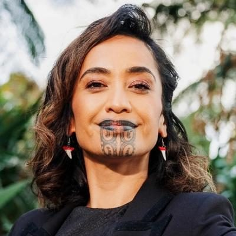

# Oriini Kaipara

| | |
|---|---|
| **Party (current/most recent)** | Te Pāti Māori |
| **Status** | MP (54th Parliament), standing in 2026 |
| **Party history** | Te Pāti Māori (2025–present) |
| **Parliaments (50th–54th)** | 54 |
| **First elected** | 2025 |
| **Electorates held** | Tāmaki Makaurau (2025–) |
| **Key roles** | MP for Tāmaki Makaurau (2025–) Co-host, Newshub Nation (2022–2023) Māori cultural lead, NZ Olympic Committee (2024) |
| **Born** | 1983, Whakatāne |
| **2026 election** | contesting Tāmaki Makaurau |
| **Wikipedia** | [Oriini Kaipara](https://en.wikipedia.org/wiki/Oriini_Kaipara) |

Photo: Supplied to policy.nz by the candidate/party — [source](https://cdn.sanity.io/images/ubdwo62y/production/11bb1c165e614177ee4603b57d0d9520c70fec70-1024x1024.jpg)

## Current status

Te Pāti Māori MP for **Tāmaki Makaurau** since winning the 6 September 2025 by-election after Takutai Tarsh Kemp's death. Standing again in Tāmaki Makaurau in 2026.

## Biography

Born in Whakatāne in 1983 (Tūhoe, Ngāti Awa, Tūwharetoa, Ngāti Rangitihi); kura kaupapa educated and trained at South Seas Film and Television School. A broadcaster and interpreter: Mai FM newsreader; TVNZ's *Waka Huia* and *Te Karere*; Māori Television's *Native Affairs*; in 2019 the first person with moko kauae to present mainstream TV news (1News), and from 2021 the first to host a prime-time bulletin (Newshub Live at 4.30); co-host of *Newshub Nation* (2022–23). Became Māori cultural lead for the NZ Olympic Committee in 2024. Acted in *We Are Still Here* and *Muru* (2022). Lives in West Auckland; four children.

## Political career

- Selected in July 2025 for the Tāmaki Makaurau by-election; won by 2,938 votes on preliminary results over Labour's Peeni Henare.
- In late October 2025 publicly supported Mariameno Kapa-Kingi during the party's disciplinary process; in May 2026 confirmed she would stand again for TPM, dismissing a report she was considering "options".

## Record & notable actions

- Supported repealing the Gangs Act 2024 ban on gang patches (August 2025 debate).

## Controversies

- Her 9 October 2025 maiden speech ran past the 15-minute limit and was followed by an unauthorised haka from the public gallery; Speaker Gerry Brownlee cleared the House and later ruled that she had disrespected parliamentary process.

<!-- GENERATED:2026-candidacy START -->
## 2026 candidacy

- **Electorate:** Tāmaki Makaurau

_Source: candidate questionnaire answers published on [policy.nz](https://policy.nz/2026/party-vote/parties/te-pati-maori), retrieved Oct 2026._
<!-- GENERATED:2026-candidacy END -->

## Sources

- https://en.wikipedia.org/w/index.php?title=Oriini_Kaipara&oldid=1372047865
- https://en.wikipedia.org/wiki/Candidates_in_the_2026_New_Zealand_general_election_by_electorate
- https://en.wikipedia.org/wiki/Te_P%C4%81ti_M%C4%81ori
- https://www.cnn.com/style/article/new-zealand-maori-news-journalist-tattoo-scli-intl/index.html
- https://www.stuff.co.nz/entertainment/tv-radio/117787888
- https://policy.nz/2026/party-vote/parties/te-pati-maori
