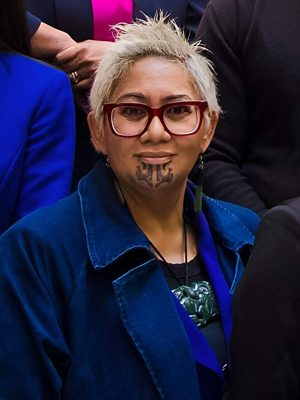

# Takutai Tarsh Kemp

| | |
|---|---|
| **Party (current/most recent)** | Te Pāti Māori |
| **Status** | Deceased |
| **Party history** | Te Pāti Māori (2023–2025) |
| **Parliaments (50th–54th)** | 54 |
| **First elected** | 2023 |
| **Electorates held** | Tāmaki Makaurau (2023–2025) |
| **Key roles** | MP for Tāmaki Makaurau (2023–2025) TPM spokesperson on social development, Whānau Ora, disabilities, mental health, family and sexual violence CEO, Manurewa Marae CEO, Rangatahi Mental Health Youth Hub (13 years) Director, Hip Hop International NZ |
| **Born** | 1975-06-20 |
| **Died** | 2025-06-26, Auckland |
| **Wikipedia** | [Takutai Tarsh Kemp](https://en.wikipedia.org/wiki/Takutai_Tarsh_Kemp) |

Photo: Office of the Clerk of the House of Representatives of New Zealand — CC BY 4.0 — [source](https://commons.wikimedia.org/wiki/File:Takutai_Moana_Kemp_2023_%28wider%29.jpg)

## Current status

Deceased. Takutai Moana Natasha "Tarsh" Kemp died on 26 June 2025, six days after her 50th birthday and hours after sitting in the House; Parliament adjourned for two weeks. She had been receiving treatment for kidney disease and was awaiting a transplant.

## Biography

Born 20 June 1975 (Ngā Rauru, Ngāti Tūwharetoa, Ngā iwi o Mōkai Pātea and others); partly raised by grandparents at Takirau marae, South Taranaki. Studied anthropology, health, education and mātauranga Māori at the University of Auckland. Founded and for 13 years led the Rangatahi Mental Health Youth Hub (with the University of Auckland) addressing Māori youth suicide; director of Hip Hop International NZ and manager for Street Dance NZ; chief executive of Manurewa Marae and a prominent South Auckland voice for COVID-19 vaccination. ONZM (2021) for services to street dance and youth. Two children; relative of minister Tama Potaka.

## Political career

- TPM candidate for Tāmaki Makaurau in 2023 (list #6); won by 4 votes on the official count over Labour's Peeni Henare, confirmed by 42 votes after a recount.
- Spokesperson for social development, Whānau Ora, disability, mental health and related portfolios; took six weeks' leave in 2024 for kidney treatment.

## Record & notable actions

- In September 2024 questioned the Health Minister about patients treated in hospital corridors, saying she had been one of them.

## Controversies

- **Census and Manurewa Marae allegations (2024–25):** former marae staff alleged that 2023 census data was misused to target voters and that incentives were offered to switch voters to the Māori roll; Kemp was implicated as candidate and former CEO. Party president John Tamihere denied wrongdoing. Stats NZ cleared the Whānau Ora Commissioning Agency in January 2025 and referred marae matters to the Privacy Commissioner; police and the Serious Fraud Office halted their inquiry in October 2025 for insufficient evidence of criminal culpability.
- The Electoral Commission was reported to be looking into a TPM campaign song played at the Manurewa Marae polling place in 2023 (other outlets said no complaints had been received).

## Sources

- https://en.wikipedia.org/w/index.php?title=Takutai_Tarsh_Kemp&oldid=1350435889
- https://www.1news.co.nz/2025/06/26/te-pati-maori-mp-takutai-tarsh-kemp-dies/
- https://www.nzherald.co.nz/kahu/hard-working-manurewa-marae-ceo-eyes-a-future-in-national-politics/ZKEYS4MYKBFCDDUEHIUJTNMLTU/
- https://www.parliament.nz/en/pb/hansard-debates/rhr/combined/HansD_20250626_20250626
