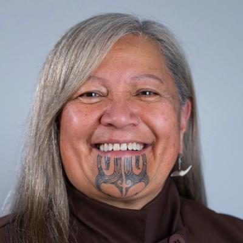

# Te Tai Tokerau Party — people

Profiles of 2 people associated with Te Tai Tokerau Party: MPs who served in the 50th–54th Parliaments (2011–2026) and every 2026 candidate listed on policy.nz. Status is as of 23 October 2026 (election day 7 November 2026). Each person sits under their current or most recent party. Click a name for the full profile.

## Current MPs (54th Parliament) (1)

| | Name | Status | 2026 electorate | 2026 list # | Roles / notes |
|---|---|---|---|---|---|
|  | [Mariameno Kapa-Kingi](mariameno-kapa-kingi/README.md) | MP (54th Parliament), standing in 2026 | Te Tai Tokerau | 2 | MP for Te Tai Tokerau (2023–); TPM whip (2023–Sept 2025); Founder, Te Tai Tokerau Party (2026) |

## 2026 candidates (1)

| | Name | Status | 2026 electorate | 2026 list # | Roles / notes |
|---|---|---|---|---|---|
|  | [Kyla Campbell-Kamariera](kyla-campbell-kamariera/README.md) | 2026 candidate |  | 1 | President, Waikato Students' Union; Chair, Mātihetihe Marae; Co-chair, Te Pāti Māori Te Tai Tokerau electorate committee (2025) |

_Built by `tools/people_others_index.py` from each profile's `person.json`. Candidate details come from policy.nz; MP histories from Wikipedia and the sources cited in each profile._
