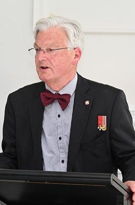

# United Future — people

Profiles of 1 people associated with United Future: MPs who served in the 50th–54th Parliaments (2011–2026) and every 2026 candidate listed on policy.nz. Status is as of 23 October 2026 (election day 7 November 2026). Each person sits under their current or most recent party. Click a name for the full profile.

## Former MPs (1)

| | Name | Status | 2026 electorate | 2026 list # | Roles / notes |
|---|---|---|---|---|---|
|  | [Peter Dunne](peter-dunne/README.md) | Former MP |  |  | Leader of United Future (2000–2017); Minister of Internal Affairs (1996, 2014–2017); Minister of Revenue (1996, 2005–2013) — Retired at the 2017 election after 33 years as MP for Ōhāriu and its predecessors; now a political commentator |

_Built by `tools/people_others_index.py` from each profile's `person.json`. Candidate details come from policy.nz; MP histories from Wikipedia and the sources cited in each profile._
