# Ballot Book NZ — redesign: information architecture

**What this is.** A rethink of how the guide is organised and laid out, not a reskin. Section 1 says what is wrong with the current structure, with screenshots of the live site (taken 23 Oct 2026 at 390px and 1280px). Section 2 sets out the new architecture: five sections, a home page with one job per election phase, one navigation model for phone and desktop, a clear relationship between the four "who agrees with me" tools, and a three-layer depth model. Section 3 walks three real users through it. Section 4 summarises the visual direction; the details are in `tokens.css`, `components.css` and `PORTING.md`.

Mockups (open directly in a browser; light/dark follow the system or the toggle):

| Screen | File | Shows |
|---|---|---|
| Today (home) | `mockups/home.html` | Phase hero, four tasks, two-votes explainer, Today feed, resume |
| Vote | `mockups/vote.html` | Five-tick checklist, "which of these are you?", electorate finder and result, voting plan |
| Choose (hub) | `mockups/choose.html` | The four tools as four lenses, why they differ |
| Quiz question | `mockups/quiz.html` | Focus mode, progress by theme, ballot-circle scale |
| Quiz results | `mockups/quiz-results.html` | All 17 parties A–Z, buckets and ranges, coverage, theme map |
| Policy swipe | `mockups/swipe.html` | Card stack, reveal, rate-not-count tally |
| Party page | `mockups/party.html` | Summary first, tabs for depth, record by term |
| Full-text reader | `mockups/party-reader.html` | Layer 3: the party's document in a sheet |
| Electorate map | `mockups/map.html` | Play scrubber, real boundaries, seat sheet |
| Polls & forecast | `mockups/polls.html` | Ranges first, frequency framing, misses shown |
| People | `mockups/people.html` | Equal-treatment directory, A–Z by surname |
| From the parties | `mockups/newsroom.html` | Equal-slot press releases, follow directory, Today panel |

---

## 1. What's wrong with the current structure

### 1.1 Eleven destinations, no hierarchy, two different menus

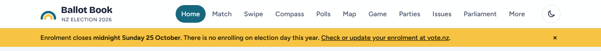

The desktop header lists **Home, Match, Swipe, Compass, Polls, Map, Game, Parties, Issues, Parliament, More**: eleven peers, with three of the four matching tools (Match, Swipe, Compass, Game) taking four of the slots. The phone tab bar shows a *different* six (Home, Match, Swipe, Polls, Parties, More), so Compass, Map, Game, Issues and Parliament exist on desktop but are hidden behind "More" on a phone. The menu is organised by *tool*, not by the question a voter is asking, so nothing tells a newcomer where to start.

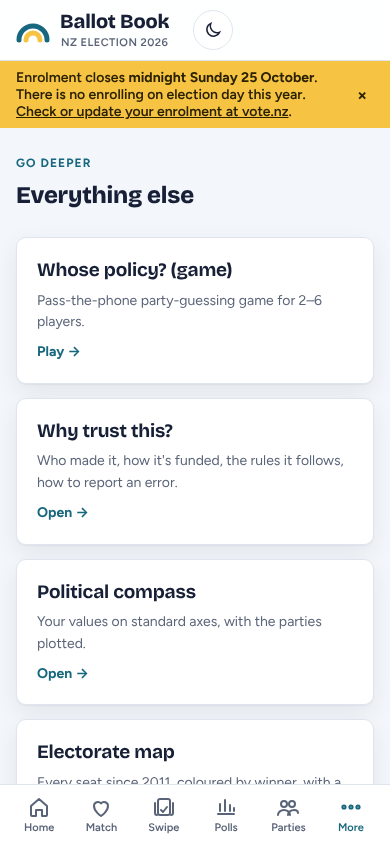

"More" is an 11,000px page of identical cards that re-lists things already in the desktop nav (Game, Compass, Map, Parliament) and holds things that are in no nav at all (Your electorate, People, Promises, every long-form page). It is a junk drawer, and it's where the first-time voter's most important page, *your electorate*, lives on a phone.

### 1.2 The home page tries to do everything, so it does nothing first

| | |
|---|---|
| 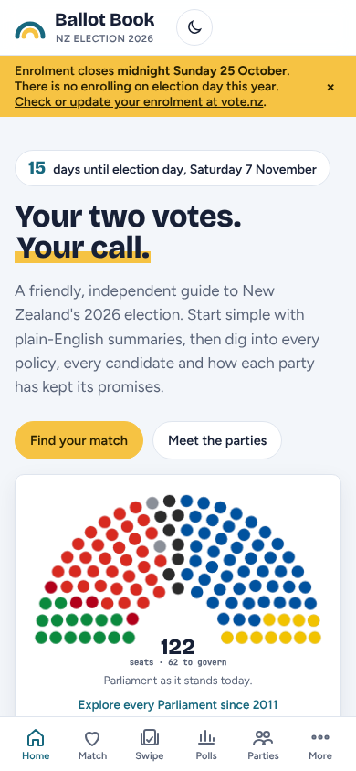 | 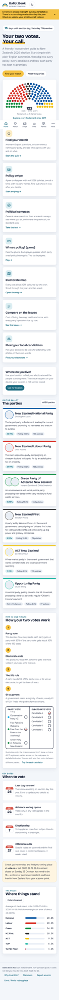 |

On a phone the home page is **6,538px** (about eight screens): countdown chip, slogan, hemicycle, seven equal "starter" cards, a location block, six party cards, an MMP explainer with an animated ballot, key dates, and a poll snapshot. Everything has the same weight, so the one thing that matters this week — *enrolment closes on Sunday and you can't enrol after that* — is a dismissible yellow strip, and the how-to-vote path is a single card among seven, below three matching tools. There is no "what's new today", so there's no reason to come back tomorrow.

### 1.3 Four tools that look like four of the same thing

The quiz, swipe, compass and game are presented as four identical cards ("Find your match", "Policy swipe", "Political compass", "Whose policy?") with no explanation of how they differ or why their answers won't agree. Each keeps its own results on its own page. The feature review's warning — "a user will inevitably get three different closest parties from three tools … otherwise it reads as incompetence" — is exactly what the current structure invites.

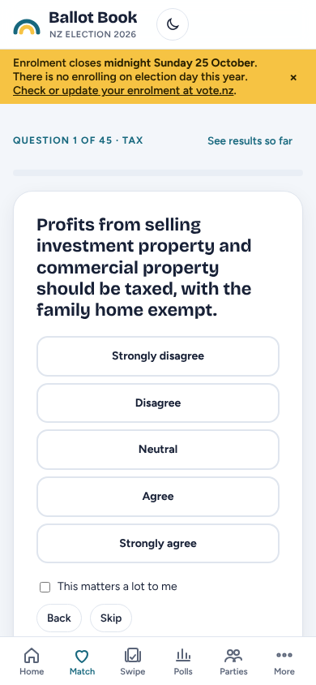

(The live quiz is still the 45-statement version; the redesign assumes v2's 30 statements on six themes.)

### 1.4 Duplicated and buried content

- **Polls** are a top-level page *and* a tab inside Parliament ("Polls & trends"). **Map** (electorates since 2011) is top-level, but **Your electorate** (the candidates where you live) is a separate view reached from Home or More, and the Parliament seat map is a third "map".
- **Issues**, **Policies** (all 1,435) and each party's **Policies** tab are three entrances to overlapping content with different filters.
- **People** (685 profiles) and **Promises** are reachable only through More or from inside a party.
- Every deeper layer — a policy's full text, a person's profile, related policies, the party README, the track record, the methodology pages — opens in **the same modal dialog**, with no URL, no back button and no sense of how deep you are.

### 1.5 Neutrality leaks in structure and style

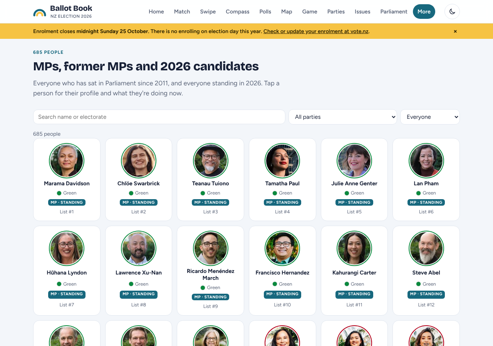

- **Ordering.** Party lists on Home, the Parties page and every issue page are sorted by current polling (`partyOrder()` and `V.issue` sort by `projection().pct`). The people directory opens on one party's MPs (above). The review is explicit: party lists should be alphabetical or in ballot order everywhere except the polls page.
- **Colour.** The current brand is a dark teal (`#17687E`) with a yellow highlight (`#F6C343`). Those sit next to TOP's teal (`#1FB5A3`) and ACT's yellow (`#F2C300`), and the main call to action on the home page, "Find your match", is a yellow button. Nobody intended it, but on a voter guide brand colour must not resemble any party.
- **Framing.** The forecast block leads with point probabilities and shows "Most likely Parliament (0.0% of simulations)" in the same visual weight as everything else.

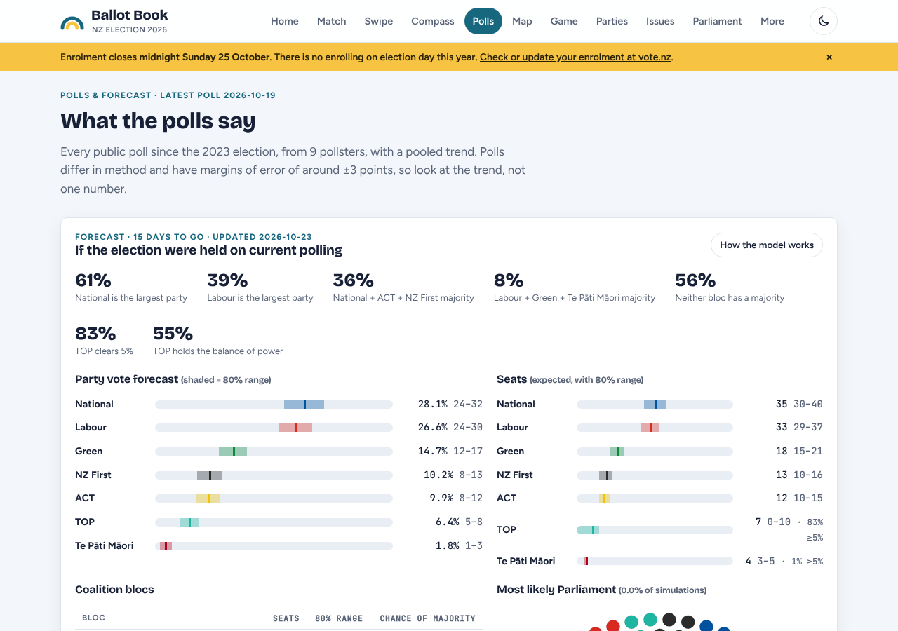

### 1.6 Phone layouts that were desktop layouts first

| | | |
|---|---|---|
| 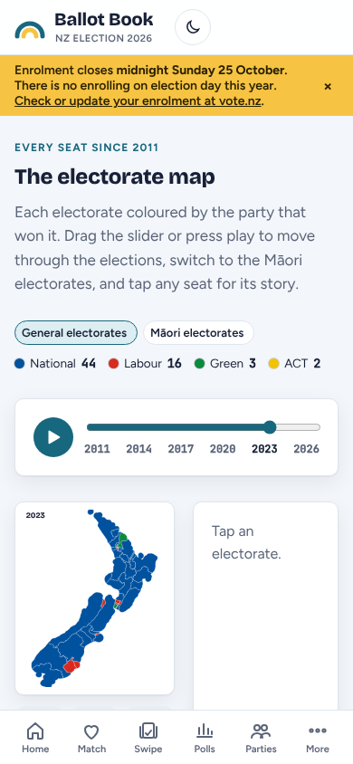 | 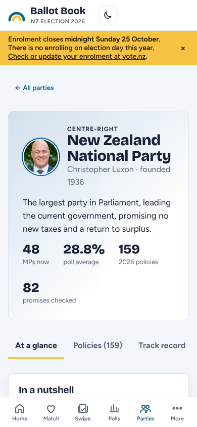 | 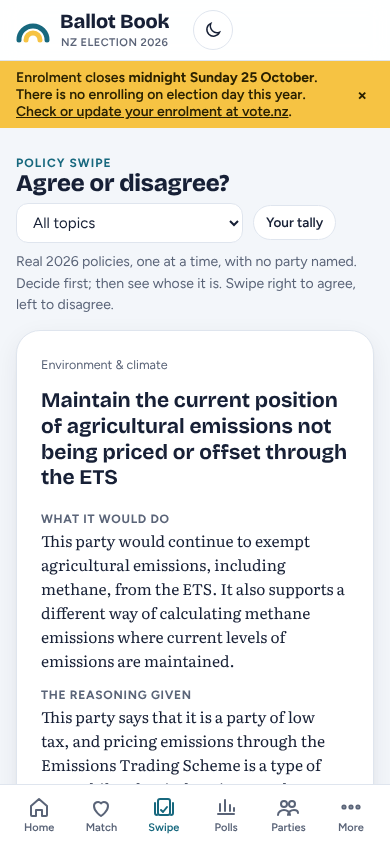 |

- The **map** keeps its two-column desktop layout at 390px: the country is a thumbnail and "Tap an electorate" sits in a half-width panel beside it.
- The **party page** spends its first screen on a gradient card with a 2×2 stat grid; the tabs then scroll sideways off screen.
- The **swipe** card fills the screen with text and pushes the agree/disagree buttons below the fold; the topic filter is a native dropdown.
- The **scrubbers** are a range input in a card, with play beside it, but the year being shown is small and the jump between years is instant, so "playing" through history doesn't feel like anything.

### 1.7 One visual weight for everything

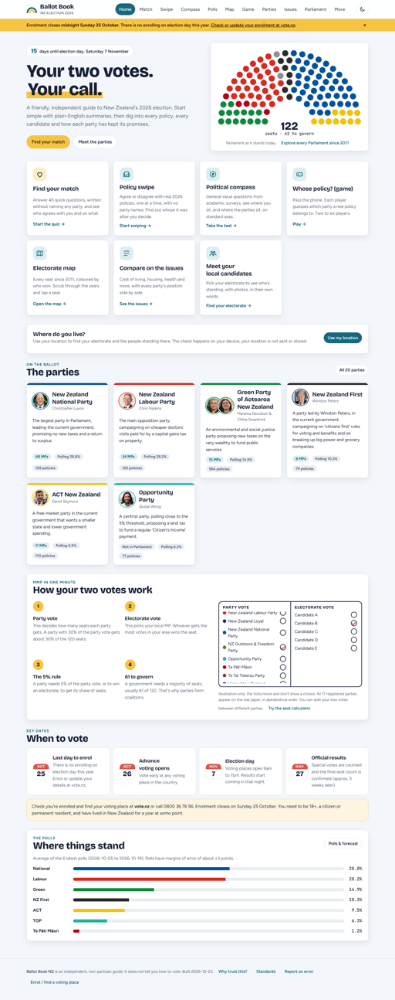

Every block is the same white, rounded, shadowed card on a blue-grey ground. Seven starter cards, six party cards, the MMP card, four date cards and the poll card all read as equals. There is no typographic or tonal signal for "this is the important thing" and none for "this is reference material you can skip".

---

## 2. The new information architecture

### 2.1 Five sections, named for the voter's question

| Section | The voter's question | What lives here | Replaces |
|---|---|---|---|
| **Today** (home) | "What do I need to do now, and what's new?" | Phase-aware next step; four task rows; two-votes explainer; Today feed (policy of the day, since yesterday, poll watch, on this day, from the parties); resume | Home, banner |
| **Vote** | "Can I vote, how, where, and who's standing near me?" | Ready-to-vote checklist; "which of these are you?" (first time, moved, away, overseas, need help, student); **your electorate** (location or suburb → electorate → candidates in ballot order → 2023 result); voting plan; MMP explained; Māori roll; special votes; glossary; print a one-pager | How-to-vote (coming), Electorate, locate block, MMP card, key dates, glossary |
| **Choose** | "Which parties agree with me?" | Hub that explains the four lenses; Policy swipe; Find your match (quiz); Values compass; Whose policy? (game); Compare two parties; **Your results** (all tools in one place, with why they differ) | Match, Swipe, Compass, Game |
| **Parties** | "What do they stand for, and can I trust it?" | 17 party pages; 17 issue explainers; all 1,435 policies by topic; promise tracker; 685 people; From the parties (press releases + follow directory) | Parties, Issues, Policies, Promises, People, newsroom (coming) |
| **Seats** | "What might happen, and what happened?" | Polls & forecast; electorate map 2011→2026; Parliament seat map; coalition builder; seat calculator; **Results** (from 7pm on 7 Nov) | Polls, Map, Parliament (+ its four tabs) |

Trust material (why trust this, standards, review log, correction form, methodology, open data) is **not a section**. It's the footer on every page, plus a "How this could be wrong" block and a source line on every result, forecast and summary — trust is shown where the claim is made, not filed in a sixth tab.

Search is global (header on every page; `/` on desktop) and returns typed results: party, person, policy, electorate, issue, glossary term.

### 2.2 The home page's job

Today does three things and nothing else:

1. **Say the one thing that matters in this phase**, in a dark "phase hero" that is the only ink-black block on the page. It carries a big number (days left), one sentence, one primary action and a four-stop calendar track with "you are here".
2. **Route by task, not by tool.** Four rows: *Can I vote, and how?* → Vote. *Who is standing where I live?* → Vote › Your electorate. *Which parties agree with me?* → Choose. *What might happen?* → Seats.
3. **Give a reason to come back.** The Today feed: one policy of the day (same card for everyone, party hidden), "since yesterday" counts, poll watch (no numbers on the home page, one tap to Seats), on this day, and three parties' latest releases in A–Z rotation. Then "pick up where you left off" from local storage.

The hero and the feed change with the election phase; everything else is stable:

| Phase | Phase ribbon | Hero | Locked |
|---|---|---|---|
| To 25 Oct | Enrolment closes in N days | "N days left to enrol" → Check I'm enrolled (vote.nz) | — |
| 26 Oct – 6 Nov | Voting is open | "Vote early, anywhere" → Find a voting place; Make a plan | — |
| 7 Nov, to 7pm | Election day, 9am–7pm (ribbon turns signal pink) | "Today's the day" → Find a voting place; what to expect inside | Choose results, polls, forecast, policy of the day (shown with the legal reason) |
| 7 Nov, 7pm → | Results coming in (live badge) | Live seat count → Results | — |
| 8 – 27 Nov | Special votes are being counted | "Final result 27 Nov" → What specials could change | — |
| After 27 Nov | Forming a government | Coalition tracker | — |

### 2.3 Navigation model

**Phone (the primary target).**
- **Header** (56px, sticky): mark + "Ballot Book", search button, theme toggle.
- **Phase ribbon** (40px, ink): the one-line message for this phase and its action. Not dismissible during the enrolment and election-day phases.
- **Bottom tab bar** (64px + safe area): Today · Vote · Choose · Parties · Seats. Five, always the same five, in the same order on every screen. The active tab has a pink marker on its top edge.
- **Sub-sections** appear as a horizontally scrolling chip row at the top of the section (e.g. Seats: Polls & forecast · Electorate map · Parliament · Coalition builder · Seat calculator · Results).
- **Focus mode** for the quiz, swipe and game: the tab bar and section chrome disappear, the header becomes "× Exit · Find your match", and progress sits at the top. One task, one screen.
- **Sheets** for layer 3 (full text, a person's profile from inside another page, a seat on the map): a bottom sheet with a grab handle, its own URL, closable with back.

**Desktop (designed, not stretched).**
- **Masthead** (72px): brand, the same five sections as text tabs with an animated pink underline, a real search field with `/` hint, theme toggle.
- **Section layout**: a 200px left rail lists the sub-sections (with counts: Policies 1,435, People 685), and the content uses a 12-column grid with deliberate asymmetric splits (7/5 on Today and Vote, 8/4 on party pages, 7/5 on map and quiz) instead of one centred column or a wall of equal cards.
- The **phase ribbon** spans the full width under the masthead.
- **Sheets** become a right-hand drawer (640px), so the page behind stays in view.

**URLs.** Every layer has a stable hash route so back works and links can be shared: `#/today`, `#/vote`, `#/vote/electorate/nelson`, `#/choose/quiz`, `#/choose/results`, `#/parties/labour`, `#/parties/labour/policies`, `#/parties/labour/doc/affordable-healthcare`, `#/seats/map/2023/nelson`, `#/seats/polls`. Old routes (`#match`, `#party-labour`, `#electorate-nelson`, `#calculator` …) redirect (see PORTING.md).

### 2.4 How the four "match-type" tools relate

They are four **lenses**, not four versions of one quiz. The Choose hub says so in one table, gives each tool its own interaction and its own illustration, and gathers every result on one **Your results** page.

| Tool | Lens | Asks about | Compares you with | Time | Interaction | Output |
|---|---|---|---|---|---|---|
| **Policy swipe** | Quick taste | Specific 2026 promises, party hidden | The parties that made them | 3 min, 20 cards | Card stack, swipe or three big buttons; reveal after each | Agreement *rate* per party (agreed ÷ seen), even sampling |
| **Find your match** | The full check | 30 broad statements on 6 themes | Each party's coded position, with sources | 8 min | Ballot-circle scale, importance toggle, randomised order | All 17 parties A–Z, bucketed (strong/moderate/weak/too few), ranges not decimals, coverage per party, theme map |
| **Values compass** | Your values | General values, nothing about NZ politics | Expert and coded party placements, both shown | 6 min | Same scale, different questions | You as a *range* on two axes; parties plotted two ways |
| **Whose policy?** | With friends | Who said what | Nobody | 3 min | Pass-the-phone, big type | Scores knowledge, never agreement |
| **Compare two parties** | Side by side | — | One party against another | — | Two columns, same fields | Big ideas, issue positions, who they'd work with |

Shared rules: party names hidden until you've answered; never a single "winner"; results never shown next to the forecast; every result has "How this could be wrong" and a link to the position table; every tool closes on election day until 7pm with the legal reason; answers stay on the device and can be exported as a link.

The hub leads with *Find your match* (the most robust of the four) as the one dark tile, with the others as equals around it, and a lens table titled **"Why they give different answers"** directly underneath.

### 2.5 How depth works: Glance → Detail → Source

Every entity has exactly three layers, and the same affordances take you down them everywhere.

| Entity | 1 · Glance (where it appears) | 2 · Detail (its own page) | 3 · Source (sheet with URL) |
|---|---|---|---|
| Party | Name, one-line tagline, MPs, poll average (Parties list, quiz rows, ballot) | Party page: nutshell, big ideas, two sides, who they'd work with, record by term, costed? — tabs for Policies, Record, People, History | The party's own document; the full profile and track record |
| Policy | Statement + party + topic (policy rows, swipe card) | Why and how, cost, related policies, similar policies from other parties | Full original text, source link, retrieval date |
| Issue | Title + why it matters (issue list) | Key facts with sources, every party's position side by side | Each position's source |
| Electorate | Name + 2023 margin (finder, map) | Candidates in ballot order, 2023 result, history since 2011, voting places | Official result, boundary map PDF |
| Person | Photo, name, party, electorate/list rank | Profile, role, record, contacts | Sources for every claim; correction route |
| Poll / forecast | Range bars and "in N of 100" | Trend, pollsters, blocs, Māori seats, track record | Method, each pollster's release |
| Promise | Verdict chip | What was said, what happened, sources | The rubric and every source |

Rules: one obvious "go deeper" control per block (a `.more` link or a row with a chevron), never a wall of buttons; layer 2 is always a page with a URL and a back route; layer 3 opens in a sheet that shows a **depth chip** (*Summary · Policy · Full text*) so you always know where you are; source lines (`.src`) are small but always visible, never hidden in an accordion.

### 2.6 Where every current feature goes

| Feature | New home |
|---|---|
| Find-your-match quiz (30 statements, 6 dimensions, coverage badges, dimension map) | Choose › Find your match; results at Choose › Your results |
| Policy swipe (party-blind cards, reveal, tally) | Choose › Policy swipe |
| Political compass | Choose › Values compass |
| Pass-the-phone game | Choose › Whose policy? (focus mode, TV-friendly) |
| Party pages (summary, big ideas, two sides, coalition stance, costed?, record by term, policies with full text, people, history) | Parties › [party] with tabs Overview · Policies · Record · People · History; full text in the reader sheet |
| 1,435 policies by topic | Parties › Policies (search + topic chips; pick a topic to compare parties in columns) |
| 17 issue explainers | Parties › Issues |
| Your electorate (71, candidates, 2023 result, location lookup) | Vote › Your electorate (also the second task on Today) |
| Electorate map 2011→2026 | Seats › Electorate map |
| Parliament seat map, coalition builder, seat calculator | Seats › Parliament / Coalition builder / Seat calculator |
| Polls (129, 9 pollsters) and forecast | Seats › Polls & forecast |
| 685 people | Parties › People; candidates also in Vote › Your electorate |
| Promise tracker | Parties › Promises (and each party's Record tab) |
| How-to-vote + first-timer checklist | Vote › Ready to vote |
| On this day | Today feed; Parties › From the parties side panel |
| Press releases + follow directory | Parties › From the parties |
| Why trust this, standards, review log, correction form | Footer on every page; "How this could be wrong" and source lines in place |
| Enrolment / voting-phase banner | Phase ribbon + Today hero |
| Election-day mode | Phase table above; locked modules show `.lock` with the reason |

---

## 3. Journeys

### 3.1 A first-time voter with five minutes

*Aroha, 18, on her phone on Friday 23 October. She's never voted and isn't sure she's enrolled.*

| # | Where | What she sees | Time |
|---|---|---|---|
| 1 | Today | Dark hero: **"2 days left to enrol."** One sentence on why it matters this year. Pink button: *Check I'm enrolled*. | 10 s |
| 2 | vote.nz (new tab) | Checks with her driver licence. She was enrolled at her parents' address; she updates it. | 2 min |
| 3 | Today → *First vote? Start here* → Vote | "Ready to vote in five ticks." Ticks 1 and 2 done. Taps **First time voting** in "Which of these are you?" and reads the 40-word callout: what happens inside. | 40 s |
| 4 | Vote › Your electorate | *Use my location — stays on your phone* → **Nelson**. "26 votes — the closest seat in the country in 2023." Seven candidates in ballot order with same-size photos. | 40 s |
| 5 | Vote › Make a plan | *Sat 7 Nov · Near home · With someone* → *Text a friend*. | 20 s |
| 6 | Today (next visit) | "Pick up where you left off: Nelson · 7 candidates." Policy of the day if she wants it. | — |

Total about four and a half minutes, and she never had to know what "electorate", "MMP" or "special vote" meant to get there; each is a glossary link if she wants it.

### 3.2 A swing voter comparing two parties

*Sam, 41, on a laptop one evening in the advance-voting week. Has voted for both of two parties before and can't decide between them.*

| # | Where | What they see |
|---|---|---|
| 1 | Today → *Which parties agree with me?* → Choose | Four lenses. Reads "Why they give different answers". Chooses *Compare two parties*, picks the two. |
| 2 | Choose › Compare | Two columns, same fields, in the order chosen (not by poll): big ideas, positions on the issues Sam ticks (housing, tax, health), who each would work with, costed? |
| 3 | Party A page → Record tab | Promises by term, with the rubric, and the note that opposition parties can mostly only "abandon". |
| 4 | Party B page → a big idea → *Read the full text* | Reader sheet opens over the page (drawer on desktop): the party's own document, retrieval date, original link. Closes with Esc/back. |
| 5 | Choose › Find your match | 30 statements, 8 minutes. Results: all 17 parties A–Z; the two parties' ranges overlap. Theme map with both parties selected shows Sam is closer to A on the economy and to B on the environment. |
| 6 | Vote › Your electorate | Sees the two parties' local candidates and the 2023 margin; reads the "your two votes can go to different parties" line. |

Nothing in the path ranks the two parties for Sam; every comparison is side by side, on the same fields, with sources.

### 3.3 A political junkie on election night

*Mere, 55, laptop on the coffee table plugged into the TV, phone in hand, 7 November from 7pm.*

| Time | Where | What she sees |
|---|---|---|
| 6:55pm | Today | Pink ribbon: "Election day — voting closes at 7pm." Choose results, polls and forecast show the lock with the legal reason. |
| 7:00pm | Today → Seats › Results | Ribbon flips to **Results coming in** with a live badge. Seats tab gains a live dot. |
| 7:30–11:30pm | Seats › Results (desktop, big screen) | Hemicycle fills as preliminary results land (seats animate in with a short stagger); "61 to govern" line; party vote bars with "% counted"; the forecast's ranges as ghost bands behind the live bars ("forecast said / count says"). |
| Throughout | Seats › Electorate map, scrubbed to 2026 | Her five starred electorates float to the top of the seat list; tapping one opens the seat sheet with the live margin and its history since 2011. |
| Throughout | Phone, Seats › Coalition builder | Tries combinations on the live seat count. |
| 11:45pm | Seats › Results | "Preliminary results exclude special votes (about 1 in 6). Final result 27 Nov." A *What specials could change* link opens the explainer. |
| 8 Nov | Today | Hero: "Final result 27 Nov" and the specials explainer; the feed carries "Forecast vs result", misses included. |

---

## 4. Visual direction (summary)

**"Ink, paper and one signal."** A cool white page, graphite ink, and a single magenta-pink signal for action, focus and *you*. Pink because no party on the 2026 ballot uses it and it isn't the Electoral Commission's orange (the guide must never look official). Party colours appear only as data: a dot, a bar, a seat, a map polygon, a 4–8px rule above a party's heading — always with a thin ring so near-black and yellow read in both themes.

Structure comes from **type and rules, not cards**: heavy 2px ink rules open each section, hairlines separate rows, and only three things get a filled surface — the dark *phase hero* (time-critical), the dark lead tool tile, and the electorate "you're in" block. Shadows are reserved for things that float (the swipe card, sheets).

Type: **Archivo** (variable width) for headings at width 108 and for big figures at width 72 — condensed, results-board numerals for countdowns, margins and seat counts; **Public Sans** (the US government's open civic typeface) for everything else. Both are Google Fonts, neither is Inter, Space Grotesk or the previous Bricolage/Figtree/Atkinson set.

Signature motifs: the **ballot tick in a circle** (logo, checklist, the quiz's five ballot circles, the "two votes" explainer), the **phase track** with a pulsing "you are here", **results-board numerals**, and **icon arrays** ("36 in 100") for every probability.

Motion (all in `tokens.css`, all off under `prefers-reduced-motion`): page enter (content rises 10px in 40ms steps; View Transitions where supported), tick draw-in, reveal wipe in the party's colour, scrubber year roll with map fills cross-fading over 560ms, seats popping in with a 14ms stagger, count-up figures, and a spring on toggles and the swipe card.
